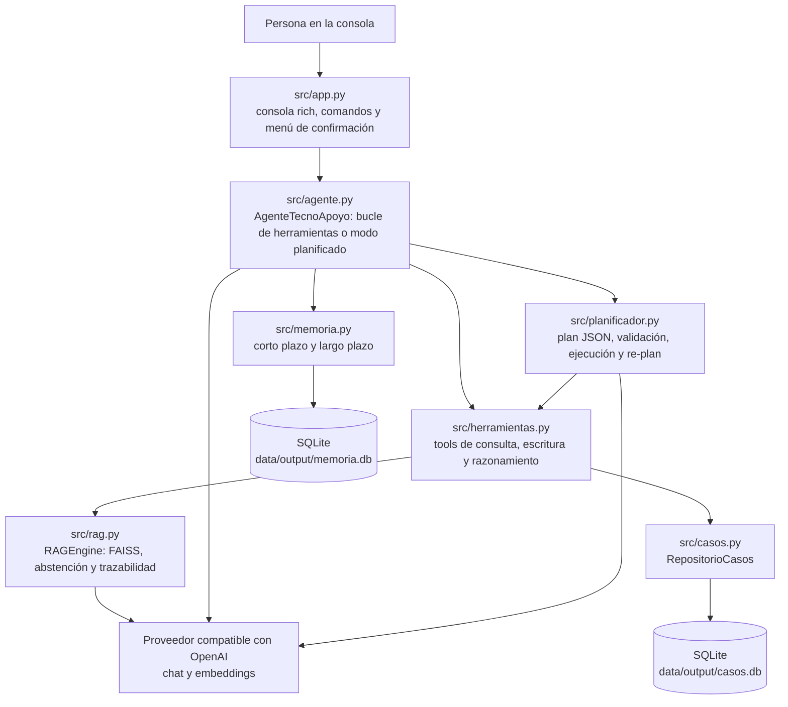
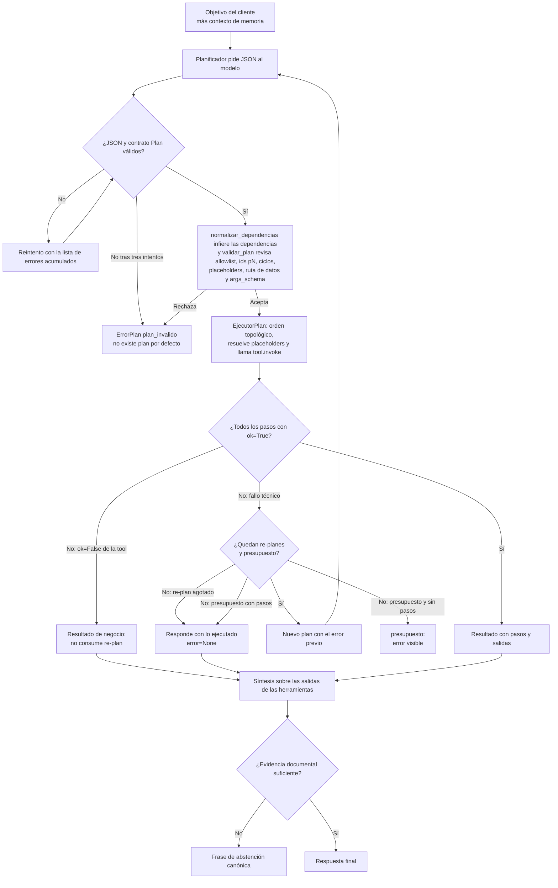

# Asistente documental y agente de soporte de TecnoApoyo

Proyecto del curso ISY0101 - Ingeniería de Soluciones con IA. TecnoApoyo es una
pyme ficticia de reparación de computadores en Santiago. El sistema responde
consultas de clientes a partir de la documentación oficial de la empresa
(procedimientos y preguntas frecuentes), se abstiene cuando no hay evidencia y,
desde RA2, opera como un agente con herramientas de consulta, escritura y
razonamiento, memoria de corto y largo plazo, y un modo de planificación
explícita con re-planificación acotada.

El motor de recuperación usa LangChain y FAISS sobre un endpoint compatible con
OpenAI. La configuración documentada apunta a la API de Mistral con
`ministral-8b-latest` para chat y `mistral-embed` para embeddings, y esos son
también los valores por defecto del código; el proveedor, el endpoint y los
modelos se pueden cambiar por variables de entorno. La clave (`LLM_API_KEY`) no
tiene valor por defecto: debe definirse en `.env`.

## Contenido

- [Qué es el proyecto](#qué-es-el-proyecto)
- [Arquitectura](#arquitectura)
- [Responsabilidades por módulo](#responsabilidades-por-módulo)
- [Requisitos e instalación](#requisitos-e-instalación)
- [Configuración](#configuración)
- [Flujo de ejecución](#flujo-de-ejecución)
- [Consola interactiva](#consola-interactiva)
- [Herramientas del agente](#herramientas-del-agente)
- [Modelo de memoria](#modelo-de-memoria)
- [Modos reactivo y planificado](#modos-reactivo-y-planificado)
- [Ciclo de planificación y re-planificación](#ciclo-de-planificación-y-re-planificación)
- [Contratos y errores](#contratos-y-errores)
- [Observabilidad](#observabilidad)
- [Mapa IL2.1-IL2.4](#mapa-il21-il24)
- [Evaluación existente](#evaluación-existente)
- [Evaluación del agente](#evaluación-del-agente)
- [Resultados medidos (2026-11-06)](#resultados-medidos-2026-11-06)
- [Límites y riesgos](#límites-y-riesgos)
- [Estructura del proyecto](#estructura-del-proyecto)

## Qué es el proyecto

Un asistente de atención al cliente que combina un motor RAG con un agente
basado en *function calling*. El agente decide qué herramienta usar en cada
paso, puede consultar la documentación y los casos de soporte, calcular plazos
en días hábiles y proponer escrituras sobre los casos. Toda escritura sobre
casos requiere confirmación humana explícita en la consola; sin confirmación no
se modifica nada.

## Arquitectura



La consola construye un `RAGEngine`, una `Memoria` y, en la primera consulta,
un `AgenteTecnoApoyo` con las herramientas ya cableadas al repositorio de casos
y al motor RAG. El agente no reemplaza al motor: lo expone como la herramienta
`buscar_documentacion`, de modo que el umbral de abstención y la recuperación
siguen siendo los del motor.

## Responsabilidades por módulo

| Módulo | Responsabilidad |
|---|---|
| `src/config.py` | Configuración central: rutas, proveedor y modelos, chunking, recuperación y variables de la capa de agentes. Resuelve rutas relativas contra la raíz y marca los valores inválidos que caen al default. |
| `src/rag.py` | `RAGEngine`: carga el índice FAISS, recupera fragmentos con score, arma el prompt fundamentado, decide la abstención por umbral o por respuesta del modelo, y devuelve documentos, latencia, tokens y error del proveedor. |
| `src/herramientas.py` | Contrato `ResultadoHerramienta`, funciones puras y tools registradas para el modelo, inyección del `Confirmador` y cálculo determinista de plazos en días hábiles. |
| `src/casos.py` | `RepositorioCasos` sobre SQLite: casos y notas, allowlist de estados y prioridades, ids secuenciales estables, siembra idempotente y `ErrorCaso`. |
| `src/agente.py` | `AgenteTecnoApoyo`: bucle de *tool calling* con tope de pasos, guard duro de abstención, integración con memoria, despacho al modo planificado y síntesis final sobre las salidas de las herramientas. |
| `src/memoria.py` | `MemoriaCortoPlazo` (buffer, ventana y resumen), `MemoriaLargoPlazo` (hechos, sesiones y turnos en SQLite), fachada `Memoria` y resumidor LLM con respaldo local. |
| `src/planificador.py` | Contrato `Plan`/`PasoPlan`, `validar_plan`, `EjecutorPlan`, `OrquestadorPlanificado` y `ErrorPlan` con códigos estables. |
| `src/observabilidad.py` | Traza por turno en JSONL con un archivo por día, saneado de claves sensibles, lectura tolerante, agregados para `/stats` y extracción de fuentes documentales. |
| `src/app.py` | Consola interactiva: comandos, confirmación de escrituras, traza por turno, fuentes documentales, estadísticas y gestión de sesiones guardadas. |
| `scripts/build_index.py` | Carga el corpus, compara configuraciones de chunking, genera embeddings y construye el índice FAISS con metadatos. |
| `scripts/generar_corpus.py` | Genera el corpus local y el dataset de evaluación sin llamar al proveedor. |
| `scripts/evaluate.py` | Evalúa el motor RAG sobre el dataset, calcula métricas, latencias y costo estimado. |
| `scripts/comparar_modos.py` | Ejecuta las mismas consultas en modo reactivo y planificado y guarda la comparación en `evaluation/results/`. |

## Requisitos e instalación

- Python 3.10 o superior.
- Acceso de red y una clave válida del proveedor para construir el índice, usar
  la consola, ejecutar la evaluación y comparar modos. La generación del corpus
  es local y no llama al proveedor.
- PowerShell para los comandos de esta guía; los mismos comandos funcionan en
  cualquier shell con el entorno virtual activado.

```powershell
python --version
python -m venv .venv
.\.venv\Scripts\Activate.ps1
pip install -r requirements.txt
pip install -r requirements-dev.txt   # solo para ejecutar las pruebas
```

Si el entorno virtual ya existe con otro nombre, reemplaza `.venv` en la ruta
de activación por el nombre real de la carpeta. Por ejemplo, con un entorno
llamado `venv`, usa `.\venv\Scripts\Activate.ps1`.

Las pruebas se ejecutan desde la raíz del proyecto:

```powershell
python -m pytest -q
```

La suite no llama al proveedor: el modelo y el motor se inyectan como dobles en
los tests del agente y del planificador.

## Configuración

`src/config.py` carga `RAIZ/.env` con `python-dotenv` si el archivo existe. Un
valor no definido toma el default de la tabla; una ruta relativa se resuelve
contra la raíz del proyecto, no contra el directorio de trabajo.

El archivo `.env.example` del repositorio no refleja la capa de agentes; esta
tabla es la fuente de verdad de las variables.

### Proveedor y recuperación

| Variable | Valor por defecto | Efecto |
|---|---|---|
| `LLM_BASE_URL` | `https://api.mistral.ai/v1` | Endpoint compatible con OpenAI para chat y embeddings. |
| `LLM_API_KEY` | vacío | Clave del endpoint. Obligatoria: sin ella el cliente no se construye. |
| `LLM_MODELO` | vacío: usa `LLM_MODEL`; si tampoco está, `ministral-8b-latest` | Modelo de chat del motor RAG y de la síntesis. |
| `LLM_MODEL` | `ministral-8b-latest` (solo si `LLM_MODELO` está vacío) | Nombre alternativo del modelo de chat, por compatibilidad con el material del curso. |
| `EMBEDDING_MODELO` | `mistral-embed` | Modelo de embeddings. El índice queda atado a este valor: si cambia, hay que reconstruirlo. |
| `TEMPERATURA` | `0.1` | Temperatura del chat. |
| `LLM_TIMEOUT_SEG` | `60` | Tope de espera de una llamada al proveedor, en segundos. Sin él el cliente hereda el default del proveedor (600 s) y una consulta queda minutos en silencio. |
| `LLM_MAX_REINTENTOS` | `1` | Reintentos del cliente ante 429/5xx/timeout. Un valor negativo se acota a 0. |
| `LLM_STREAM` | `1` | Respuesta en streaming por la consola. Solo `0`, `false`, `no` u `off` lo desactivan y vuelven al panel único. |
| `TOP_K` | `3` | Cantidad de fragmentos que recupera el motor RAG. |
| `UMBRAL_ABSTENCION` | `0.45` | Similitud mínima para intentar responder. Debe recalibrarse si cambia el modelo de embeddings. |

`LLM_MODEL_SMALL` no se lee en el código. `OPENAI_API_KEY` tampoco: el runtime
usa `LLM_BASE_URL` y `LLM_API_KEY`. Las variables `LANGCHAIN_TRACING_V2`,
`LANGCHAIN_API_KEY` y `LANGCHAIN_PROJECT` las consume LangSmith cuando la
librería está instalada y el trazado está activo; el proyecto no las lee
directamente.

### Clave del proveedor desde la consola

Con `LLM_API_KEY` vacía la app no arranca: `src/app.py` corta el arranque con
una instrucción, no con el traceback de `OpenAIError`. Para guardarla en `.env`:

```
python -m src.configurar_clave
```

El comando la pide con `getpass` (no se muestra y no queda en el historial de
la shell), la valida contra `GET {LLM_BASE_URL}/models` —sin consumir tokens— y
escribe **solo** la línea `LLM_API_KEY=` en `.env`, conservando el resto del
archivo. Un 401/403 no se guarda; un fallo de red se guarda con advertencia,
para poder configurar sin conexión. Nunca acepta la clave como argumento: un
`--clave VALOR` quedaría en el historial de la shell y en la lista de procesos.

`load_dotenv` no sobrescribe una variable ya presente en el entorno: si
`LLM_API_KEY` está exportada en la shell, esa gana sobre `.env`, y el comando lo
advierte al guardar.

### Capa de agentes, memoria y planificación

| Variable | Valor por defecto | Efecto |
|---|---|---|
| `AGENTE_MAX_PASOS` | `6` | Tope de iteraciones del bucle reactivo y tope que el agente pasa al planificador. Un valor menor que 1 se eleva a 1. |
| `AGENTE_MODELO` | vacío: usa `LLM_MODELO` | Modelo que decide las llamadas a herramientas y produce el plan. |
| `MEMORIA_ESTRATEGIA` | `ventana` | Estrategia de corto plazo: `buffer`, `ventana` o `resumen`. Un valor no reconocido cae a `ventana`. |
| `MEMORIA_VENTANA` | `6` | Turnos conservados por la estrategia de ventana. Un valor menor que 1 se eleva a 1. |
| `MEMORIA_RESUMIDOR` | `llm` | Resumidor de la estrategia `resumen`: `llm` (con respaldo local) o `local` (sin red). Un valor no reconocido cae a `llm`. |
| `AGENTE_MODO` | `planificado` | Modo inicial: `reactivo` o `planificado`. Un valor no reconocido cae a `planificado`. |
| `PLAN_MAX_PASOS` | `6` | Tope de pasos de un plan y presupuesto global por consulta en modo planificado. Es independiente de `AGENTE_MAX_PASOS`, que gobierna el bucle reactivo. |
| `PLAN_MAX_REPLANES` | `1` | Re-planificaciones permitidas por consulta. `0` desactiva el re-plan. |
| `RUTA_CASOS` | `data/output/casos.db` | Base SQLite de casos de soporte. |
| `RUTA_MEMORIA` | `data/output/memoria.db` | Base SQLite de hechos y sesiones. |
| `RUTA_TRAZAS` | `data/output/trazas` | Directorio de trazas: un archivo JSONL por día (`trazas_AAAA-MM-DD.jsonl`). |

### Evaluación

| Variable | Valor por defecto | Efecto |
|---|---|---|
| `TARIFA_IN_CLP` | `145` | CLP por millón de tokens de entrada, usados por `scripts/evaluate.py` para el costo estimado. |
| `TARIFA_OUT_CLP` | `580` | CLP por millón de tokens de salida. |

No son tarifas verificadas del proveedor: son referencias configurables. Antes
de interpretar el costo como representativo, define ambas con las tarifas
vigentes.

Rutas fijas, no configurables por entorno: `data/corpus/`,
`evaluation/dataset_evaluacion.json`, `evaluation/results/`,
`data/output/indice_faiss/`, `data/output/documentos.json` y la semilla de casos
`data/casos_semilla.json`.

## Flujo de ejecución

Ejecuta los pasos desde la raíz del proyecto y en este orden.

1. Genera el corpus y el dataset de evaluación. Es local, sin llamadas al
   proveedor:

   ```powershell
   python scripts/generar_corpus.py
   ```

   Salida esperada: 10 procedimientos, 30 FAQ y 41 consultas (31 respondibles y
   10 de abstención), además de `data/entidades.json`.

2. Construye el índice FAISS. Solicita embeddings y ejecuta una consulta de
   prueba al modelo de chat, así que puede generar cargos reales:

   ```powershell
   python scripts/build_index.py
   ```

   El script compara las tres configuraciones de chunking de
   `config.CONFIGURACIONES_CHUNKING` (200/20, 350/50 y 500/75), escribe el
   reporte en `data/output/chunking_report.json` y elige la configuración cuya
   longitud media queda más cerca de su `chunk_size`. El índice y sus metadatos
   quedan en `data/output/`. En la ejecución documentada se generaron 78 chunks
   con 200 caracteres y overlap de 20. Reconstruye el índice si cambia
   `EMBEDDING_MODELO` o el corpus.

3. Inicia la consola. La invocación como módulo debe ejecutarse desde la raíz y
   requiere el índice del paso anterior; sin él, `python -m src.app` falla con
   un `FileNotFoundError` que indica ejecutar `build_index.py`:

   ```powershell
   python -m src.app
   ```

4. Ejecuta la evaluación del motor RAG sobre las 41 consultas. Llama al
   proveedor y escribe resultados con fecha y hora en `evaluation/results/`
   como `.json` y `.txt`:

   ```powershell
   python scripts/evaluate.py
   ```

5. Opcional: compara los dos modos del agente con las mismas consultas. Requiere
   red e índice construido, y escribe
   `evaluation/results/comparacion_modos_<marca>.json`:

   ```powershell
   python scripts/comparar_modos.py
   python scripts/comparar_modos.py "¿Cuánto demora el diagnóstico?"
   ```

   Sin argumentos usa cinco consultas por defecto. Las escrituras se rechazan
   con un confirmador que siempre responde que no, de modo que la comparación
   mide selección de herramientas y orquestación, no la confirmación humana.

## Consola interactiva

La consola responde a través del agente, mantiene el historial de la sesión y
escribe una traza por turno en `RUTA_TRAZAS`. Los comandos se reconocen sin
distinguir mayúsculas.

Mientras corre una consulta, la consola imprime una línea por paso ejecutado
(`→ herramienta | ok=sí|no`) y escribe la respuesta final a medida que el modelo
la produce, ya formateada como Markdown en el mismo bloque: al terminar no se
repite. `LLM_STREAM=0` desactiva el streaming y vuelve al panel único. En modo
planificado las líneas de paso se agrupan por plan, porque el planificador
ejecuta el plan completo antes de devolver el control.

La confirmación de una escritura es un menú: `↑`/`↓` para mover, `Enter` para
elegir y `Esc` para cancelar; la opción preseleccionada es **No, cancelar**, así
que un Enter accidental no escribe nada. Si la terminal no entrega teclas (por
ejemplo con la entrada redirigida), cae a una lista numerada donde `Enter`
también cancela.

| Comando | Acción |
|---|---|
| `/ayuda` | Muestra los comandos disponibles. |
| `/trazo on` | Muestra los pasos ejecutados, su estado y las fuentes documentales con su relevancia. |
| `/trazo off` | Oculta la traza de pasos y fuentes. |
| `/plan` | Muestra el plan validado como card: pasos, argumentos y criterios. |
| `/plan json` | Muestra el JSON crudo del plan, para copiar. |
| `/plan on` | Muestra el plan al final de cada turno planificado. |
| `/plan off` | Deja de mostrarlo automáticamente. |
| `/modo` | Muestra el modo actual (`reactivo` o `planificado`). |
| `/modo reactivo` | Cambia al bucle reactivo para las siguientes consultas. |
| `/modo planificado` | Cambia al modo con plan y re-planificación. |
| `/cliente` | Muestra el cliente seleccionado para la sesión, o avisa que no hay ninguno. |
| `/cliente <nombre>` | Selecciona el nombre usado para filtrar los casos de la consola. Acepta nombres con espacios; no verifica la identidad. |
| `/cliente borrar` | Quita el cliente seleccionado. Sin cliente, las consultas de casos solicitan seleccionar uno. |
| `/guardar` | Abre una sesión nueva en `memoria.db` y escribe los turnos acumulados del motor (pregunta y respuesta de cada consulta). No acepta argumentos. |
| `/sesiones` | Lista las últimas 20 sesiones guardadas con su identificador y fecha de creación. |
| `/cargar <id>` | Restaura los turnos de una sesión en la memoria de corto plazo y la deja activa. Si no existe, no altera la memoria actual. |
| `/memoria` | Lista los hechos recordados del usuario con su fecha de actualización. |
| `/memoria borrar <clave>` | Borra un hecho recordado. Informa si la clave no existía. |
| `/trazas` | Muestra las últimas 10 trazas del día con hora, modo, cantidad de pasos, tokens, abstención y error. |
| `/stats` | Resume las trazas persistidas: consultas, abstenciones, pasos totales, distribución de herramientas y de modos. |
| `/salir` | Termina la aplicación. También acepta `/exit` y `/quit`. |

Cada `/guardar` crea una sesión nueva con el historial acumulado hasta ese
momento; no vacía el historial ni actualiza una sesión anterior.

`/modo` cambia `config.AGENTE_MODO` en memoria y el agente se reconstruye en la
siguiente consulta. El cambio no se persiste en `.env`: al reiniciar, vuelve al
valor de `AGENTE_MODO`.

`/cliente` fija el cliente de la sesión y también reconstruye el agente en la
siguiente consulta. El valor vive solo en la sesión (`config.CLIENTE_ACTUAL` en
memoria) y no se escribe en `.env`.

El agente también puede identificar al cliente en la conversación con la tool
`identificar_cliente`, disponible solo en la consola: si el usuario declara su
nombre, la sesión queda atada a él sin escribir el comando. Las tools leen el
cliente en vivo, así que el mismo plan ya puede listar sus casos; si el nombre
no tiene casos, la tool no cambia el alcance y explica el motivo.

Con alcance de sesión, el listado y las operaciones sobre un caso por su ID se
limitan al nombre seleccionado. Sin cliente seleccionado, solicitan
`/cliente <nombre>`. Los scripts (`evaluar_agente.py`, `demo_agente.py`,
`comparar_modos.py`) usan alcance global y siguen viendo el dominio completo.

**Límite de privacidad:** `/cliente` y la tool `identificar_cliente` son un
filtro declarado por la persona que usa la consola, no un inicio de sesión ni
una verificación de identidad: se puede seleccionar otro nombre. Además, la
memoria, el historial y las sesiones guardadas no quedan aislados por cliente.
No uses este mecanismo como control de acceso ni con datos reales de varios
clientes sin autenticación y aislamiento adicionales.

Para una prueba rápida dentro del alcance documentado, consulta `¿Cuánto cuesta
el diagnóstico básico?`. Como prueba fuera de alcance, usa `¿Cuál es el estado
de mi orden de servicio 4590?`: la aplicación no consulta estados de órdenes y
el asistente debe abstenerse.

## Herramientas del agente

`src/herramientas.py` expone nueve tools al modelo; el agente agrega `recordar`
cuando tiene memoria. Todas devuelven JSON serializable con el contrato
`ResultadoHerramienta`.

La columna `datos` es el contrato de salida declarado en `CLAVES_SALIDA`, una
tabla única por tool. De ahí sale la validación de los caminos `{{pN.datos...}}`
del modo planificado (ver [Validación determinista](#validación-determinista)) y
de ahí se documenta el docstring de cada tool, que es lo que lee el modelo. Solo
se declara el primer nivel: lo que hay dentro de `casos`, `fragmentos` o `notas`
se resuelve con el dato real al ejecutar.

| Herramienta | Familia | Argumentos | Efecto | `datos` | ¿Confirmación humana? |
|---|---|---|---|---|---|
| `buscar_documentacion` | consulta | `pregunta` (3 a 500 caracteres), `k` (1 a 10, por defecto 3) | Recupera fragmentos de la documentación y decide si la evidencia alcanza el umbral. No redacta la respuesta. | `fragmentos`, `mejor_score`, `umbral`, `evidencia_suficiente` | No |
| `consultar_caso` | consulta | `id_caso` con formato `CASO-NNNN` | Devuelve el caso con sus notas cuando está dentro del alcance seleccionado, o un error si no está disponible. | campos del caso (ver abajo) | No |
| `listar_casos` | consulta | `estado` opcional (allowlist), `limite` (1 a 50, por defecto 10) | Lista casos del más reciente al más antiguo (orden por `id` descendente) con el total real de casos que cumplen el filtro, no el tamaño de la página. Con alcance de sesión solo devuelve los casos del cliente fijado con `/cliente`; sin cliente identificado responde `ok=False` y no lista nada. | `casos`, `total` | No |
| `identificar_cliente` | identificación | `nombre` (2 a 120 caracteres) | Ata la sesión al cliente que la persona declara **en el mensaje del turno actual**: las tools de caso pasan a operar sobre sus casos. Un correo, o un nombre que no aparezca en ese mensaje (memoria, historial), responde `ok=False` sin repetir el valor y sin cambiar el alcance; si el nombre no tiene casos, también responde `ok=False`. Solo existe en alcance de sesión (consola). | `cliente`, `casos` | No |
| `crear_caso` | escritura | `cliente`, `categoria`, `descripcion`, `prioridad` (`baja`, `media`, `alta`; por defecto `media`), `procedimiento` opcional `PROC-NNN` | Crea un caso con id secuencial `CASO-NNNN` y estado `abierto`. | campos del caso (ver abajo) | Sí |
| `agregar_nota` | escritura | `id_caso`, `nota` (3 a 1000 caracteres) | Agrega una nota al caso en la tabla `casos_notas`. | campos del caso (ver abajo) | Sí |
| `actualizar_estado` | escritura | `id_caso`, `estado` (`abierto`, `en_progreso`, `escalado`, `cerrado`) | Cambia el estado del caso. La confirmación muestra el estado anterior y el nuevo. | campos del caso (ver abajo) | Sí |
| `escalar_a_humano` | escritura | `id_caso`, `motivo` (3 a 500 caracteres) | Marca el caso como `escalado` y deja el motivo como nota con el prefijo `Escalado:`. | campos del caso (ver abajo) | Sí |
| `calcular_plazo` | razonamiento | `tipo_servicio`, `fecha_inicio` ISO opcional (por defecto hoy), `dias_habiles_extra` (0 a 30) | Calcula la fecha comprometida en días hábiles. Es determinista y no usa el modelo. | `tipo_servicio`, `fecha_inicio`, `dias_habiles_base`, `dias_habiles_extra`, `dias_habiles_totales`, `fecha_estimada` | No |
| `pedir_datos` | conversación | `pregunta` (3 a 500 caracteres) | Pregunta al usuario el dato que falta (por ejemplo el cliente o el id del caso) en vez de inventarlo. El plan que la usa debe tener ese único paso y la respuesta del turno es la pregunta, tal cual, sin síntesis. | `pregunta` | No |
| `recordar` | memoria | `clave` (2 a 60 caracteres), `valor` (2 a 500 caracteres) | Guarda o actualiza un hecho duradero del usuario. Solo existe si el agente recibió una memoria. | `usuario`, `clave`, `valor`, `actualizado_en` | No |

Campos del caso que devuelven `consultar_caso`, `crear_caso`, `agregar_nota`,
`actualizar_estado` y `escalar_a_humano` (`CAMPOS_DE_CASO`): `id`, `cliente`,
`categoria`, `descripcion`, `prioridad`, `estado`, `procedimiento`,
`fecha_creacion` y `notas`. El identificador del caso es `id`: no existe
`datos.id_caso`, y un placeholder que lo use se rechaza con
`ruta_desconocida`.

Plazos base de `calcular_plazo`, tomados de la tabla `PLAZOS_HABILES` del
módulo:

| `tipo_servicio` | Días hábiles |
|---|---:|
| `diagnostico` | 2 |
| `revision` | 1 |
| `reparacion` | 5 |
| `repuesto` | 7 |
| `formateo` | 1 |
| `respaldo_datos` | 2 |
| `mantenimiento_preventivo` | 3 |
| `actualizacion_software` | 2 |

El cálculo suma `dias_habiles_extra`, salta sábados y domingos y no considera
feriados. Un tipo desconocido o una fecha inválida devuelven `ok=False` con el
detalle.

Las herramientas de escritura no incluyen un campo `confirmado` en su esquema y
los esquemas declaran `extra="forbid"`: si el modelo envía un campo no
declarado, la validación Pydantic rechaza la llamada completa y no se ejecuta
ninguna escritura. La confirmación es una función `Confirmador` que inyecta el
ejecutor; la consola la implementa con `rich.prompt.Confirm` y valor por
defecto `False`. Sin confirmador, o si la persona responde que no, la
herramienta devuelve `ok=False` y el caso no se modifica.

## Modelo de memoria

La memoria tiene dos horizontes y una fachada que los combina.

### Corto plazo

`MemoriaCortoPlazo` mantiene el historial que viaja en el prompt del agente.
`MEMORIA_VENTANA` cuenta turnos, es decir mensajes individuales
(`usuario` o `asistente`), no pares de pregunta y respuesta. Hay tres
estrategias:

| Estrategia | Comportamiento |
|---|---|
| `buffer` | Conserva todos los turnos, sin recorte. |
| `ventana` | Conserva los últimos `MEMORIA_VENTANA` turnos y descarta los anteriores. Es el default. |
| `resumen` | Conserva los últimos `MEMORIA_VENTANA` turnos y pliega los que salen de la ventana con un resumidor. |

El resumidor de la estrategia `resumen` se elige con `MEMORIA_RESUMIDOR`:

- `llm` (default): `resumir_con_llm` pide al modelo un resumen acotado a 120
  palabras, conservando hechos, preferencias, identificadores `CASO-NNNN` y
  decisiones. Va envuelto en `ResumidorConFallback`: si el proveedor falla, usa
  el resumidor local y cuenta el fallo en `fallos`.
- `local`: usa siempre `resumidor_por_defecto`, que concatena `rol: contenido`
  y conserva la cola más reciente hasta 600 caracteres. No toca la red.

Si se pide `llm` sin un modelo inyectado, `crear_resumidor` devuelve el
resumidor local: el arranque no depende de que el proveedor esté disponible. El
resumidor local es un respaldo, no la estrategia de resumen: concatenar y
recortar conserva texto, pero no condensa.

### Largo plazo

`MemoriaLargoPlazo` persiste en SQLite (`RUTA_MEMORIA`):

- **Hechos**: una fila por `(usuario, clave)` con `valor` y `actualizado_en`. Un
  segundo `recordar` sobre la misma clave actualiza el valor, no duplica la
  fila. El usuario por defecto es `por_defecto`.
- **Sesiones**: identificadores secuenciales `SES-NNNN` con fecha de creación.
- **Turnos**: `rol`, `contenido` y fecha, asociados a una sesión. Un turno de
  una sesión inexistente se rechaza.

Los hechos relevantes para una consulta se eligen por coincidencia léxica de
palabras: se normalizan a minúsculas y sin tildes, se descartan palabras vacías
y las de menos de tres letras, y se puntúa cuántas palabras de la consulta
aparecen en la clave o el valor. Los empates se resuelven por recencia y, si no
hay ninguna coincidencia, se usan los hechos más recientes. El bloque inyectado
respeta un presupuesto de 400 caracteres. Es una selección léxica, no semántica.

La fachada `Memoria` agrega cada turno al corto plazo y, si hay una sesión
abierta, también lo persiste. La sesión se abre con `/guardar` o `/cargar`; sin
una sesión abierta, los turnos viven solo en el corto plazo del proceso.

El agente compone el prompt de sistema con dos bloques, en este orden:
`Historial reciente:` (el texto del corto plazo, recortado a 1500 caracteres
conservando la cola) y `Memoria relevante del usuario:` (los hechos
seleccionados). El planificador recibe el mismo contexto. Sin memoria, el prompt
queda igual que antes. La tool `recordar` permite guardar hechos; un fallo de
memoria no interrumpe la conversación.

### Comandos de memoria

| Comando | Efecto |
|---|---|
| `/memoria` | Tabla de hechos del usuario con clave, valor y fecha de actualización. |
| `/memoria borrar <clave>` | Borra el hecho indicado; informa si no existía. |
| `/sesiones` | Lista las sesiones guardadas. |
| `/cargar <id>` | Restaura una sesión en el corto plazo y la deja activa. Si el id no existe, lanza `ErrorMemoria` antes de tocar el historial, así que la sesión actual no se pierde. |
| `/guardar` | Guarda el historial acumulado como una sesión nueva y devuelve su id. |

## Qué puede hacer el agente

La respuesta a «¿qué puedes hacer?» es determinista: no llama al modelo y no
gasta tokens de contexto. `src/capacidades.py` declara las capacidades
(`CAPACIDADES`, enlazadas a las tools de `CLAVES_SALIDA`) y el texto canónico
(`TEXTO_CAPACIDADES`); un test exige que la unión cubra todas las tools
declaradas, así que agregar una tool sin documentar su capacidad rompe la
suite.

El detector ignora saludos y tildes, y solo intercepta la pregunta de
capacidades: `¿qué puedes hacer?`, `¿para qué sirves?`, `cuáles son tus
capacidades`, `en qué me puedes ayudar`, `¿qué hace el agente?`. Una consulta
operativa como `¿qué puedes hacer con mi caso?` sigue el camino normal.

La consola muestra el paso y el texto completo:

```
  → capacidades | ok=sí
Puedo ayudarte con esto:
- Documentación: políticas, procedimientos, precios, garantías y horarios, citando la documentación oficial. Si la evidencia no alcanza, te lo digo en vez de inventar.
- Casos: consultar el estado de un caso por su número (CASO-0000) y listar tus casos.
- Escrituras: crear un caso, agregar una nota, cambiar su estado o escalarlo a una persona; siempre te pido confirmación antes de escribir.
- Plazos: calcular la fecha comprometida en días hábiles.
- Datos faltantes: pedirte el dato que me falte, en vez de suponerlo.
- Memoria: guardar hechos que me pidas recordar, cuando la memoria está activa.

No puedo ver casos de otros clientes ni responder sin respaldo documental.
```

`capacidades` no es una tool del modelo: es un paso determinista del agente,
por eso no aparece en el catálogo ni en `CLAVES_SALIDA`, y la traza lo registra
con `tokens_total = 0`. Tampoco se guarda en la memoria de corto plazo: el
texto canónico no es contexto conversacional y no reaparece en los prompts de
turnos futuros. Sí queda en la traza y en el historial de la consola.

## Modos reactivo y planificado

El agente tiene dos formas de resolver una consulta, comparables entre sí:

- **Reactivo** (`AGENTE_MODO=reactivo`): el modelo recibe la pregunta y
  las herramientas, elige llamadas, el ejecutor las corre y devuelve cada
  resultado como `ToolMessage`. Repite hasta que el modelo deja de pedir
  herramientas o se agota `AGENTE_MAX_PASOS`. En cada iteración decide con el
  resultado de la anterior; no hay un plan previo.
- **Planificado** (`AGENTE_MODO=planificado`, por defecto): antes de tocar una herramienta,
  el modelo produce un plan JSON con objetivo, pasos, dependencias y criterio de
  éxito. El plan se valida de forma determinista, se ejecuta en orden
  topológico y, si un paso falla por una causa técnica, el orquestador puede
  re-planificar dentro del presupuesto. Un `ok=False` de la herramienta es un
  resultado de negocio y no consume re-plan: el turno responde con lo ejecutado.
  Una escritura confirmada tampoco consume re-plan: el plan nuevo podría repetir
  el mismo paso y duplicar el caso, así que el turno responde con lo que ya se
  hizo.
  La respuesta final se redacta sobre las salidas reales de las herramientas.
  Si el plan es un único `pedir_datos`, el turno no sintetiza: muestra esa
  pregunta al usuario y termina, sin ejecutar nada más.

Cómo compararlos:

1. Cambia el modo en caliente con `/modo reactivo` o `/modo planificado`, o fija
   `AGENTE_MODO` en el entorno antes de arrancar.
2. Ejecuta `python scripts/comparar_modos.py` para medir ambos modos sobre las
   mismas consultas. El script registra respuesta, abstención, error, lista de
   herramientas, cantidad de pasos, re-planes, tokens, latencia y plan
   ejecutado.
3. Cambia las consultas pasándolas como argumentos; sin argumentos usa cinco
   consultas de prueba.

En ambos modos el guard de abstención es el mismo: si la última
`buscar_documentacion` indicó que la evidencia no alcanza y ninguna herramienta
de caso recuperó datos después, el ejecutor impone la frase canónica aunque el
modelo haya redactado una respuesta. La abstención queda bajo el control del
ejecutor, no del modelo.

### Patrones de razonamiento

El proyecto usa dos patrones con nombre técnico; ninguno es «cadena de
pensamiento» (CoT), porque no expone un razonamiento libre en prosa.

- **ReAct (modo reactivo)**: razona, actúa con una herramienta y observa el
  `ToolMessage`; repite hasta responder o agotar `AGENTE_MAX_PASOS`. Se
  implementa con *function calling* nativo, sin el andamiaje textual
  Thought/Action/Observation.
- **Plan-and-execute (modo planificado)**: el modelo emite un plan JSON
  (`objetivo`, `reflexion`, `pasos`, `depende_de`, `criterio_exito`) antes de
  tocar nada; el sistema lo valida de forma determinista y lo ejecuta en orden
  topológico, con re-plan acotado ante fallos técnicos. El plan es el artefacto
  de razonamiento auditable; no se guarda ni se muestra el CoT interno del
  modelo. `reflexion` explica por qué ese plan y no otro, y la card lo muestra
  como `por qué · ...`.

En el modo reactivo, `RespuestaAgente.pensamientos` guarda el texto que el
modelo emite antes de cada herramienta y el `reasoning_content` del proveedor
cuando lo entrega. La consola lo muestra en dim italic si no hay streaming; con
streaming ese texto ya se transmite. No se fuerza el razonamiento: si el
proveedor no lo emite, la lista queda vacía. La traza JSONL guarda `plan`,
`pensamientos` y los pasos.

El plan validado se puede inspeccionar con `/plan` (card del último turno),
`/plan json` (el JSON crudo) o `/plan on` (al final de cada turno planificado);
el modo reactivo no genera plan. La traza JSONL también lo guarda en el campo
`plan`.

### Identidad: solo el nombre que la persona declara en el turno

La sesión trae `Contexto disponible` con el historial y los hechos de memoria
(`correo = ...` entre ellos). Ese contexto es útil para redactar, pero no prueba
quién está escribiendo: alguien que nunca dijo su nombre no queda identificado
porque la memoria tenga su correo.

Por eso la identidad tiene una sola fuente, y es el ejecutor quien la publica:

- `AgenteTecnoApoyo.consultar` publica el mensaje del turno en un `ContextVar`
  (`src.herramientas.mensaje_del_turno`) antes de ejecutar cualquier tool, en los
  dos modos, y lo restablece al terminar el turno. La memoria y el historial no
  se publican: no son el turno.
- `identificar_cliente` solo acepta un nombre que aparezca en ese mensaje
  (comparando sin mayúsculas ni tildes). Un valor con `@` o un nombre que no
  aparezca responde `ok=False`, no repite el valor rechazado y no llama a
  `al_identificar`, así que el alcance de la sesión no cambia.
- Sin mensaje publicado (una tool invocada fuera de un turno) falla cerrado: no
  identifica a nadie.

Los dos modos comparten además las mismas reglas de dominio: viven en
`REGLAS_DOMINIO` (`src/agente.py`), el prompt del modo reactivo las usa y el
planificador las interpola en `PROMPT_SISTEMA_PLAN`. No hay una segunda copia
del texto que pueda divergir. Incluyen que el dominio no tiene correo, que no se
enumeran casos de otros clientes, que no se inventan procedimientos `PROC-*`,
que las escrituras solo se proponen y que no se identifica con datos de memoria.

## Ciclo de planificación y re-planificación



Un plan de un solo `pedir_datos` también pasa por la validación y se ejecuta,
pero no llega a la síntesis: `AgenteTecnoApoyo` toma `datos.pregunta` del paso y
la devuelve tal cual, para que el usuario reciba la pregunta y no una paráfrasis
de ella. Ese camino no cuesta una segunda llamada al modelo.

### Validación determinista

`validar_plan` no confía en el prompt. Rechaza el plan si:

- supera `PLAN_MAX_PASOS`;
- un id no tiene formato `pN` o está repetido;
- una dependencia de `depende_de` no existe;
- las dependencias forman un ciclo, lo que se detecta antes de ejecutar
  cualquier paso;
- una herramienta no está en la allowlist de tools registradas;
- un placeholder `{{pN.camino}}` referencia un paso que no está declarado en
  `depende_de`;
- el camino de un placeholder no empieza por `datos`, o su clave siguiente no
  está declarada para esa tool en `CLAVES_SALIDA` (código
  `ruta_desconocida`, con las claves válidas en el mensaje);
- un plan usa `pedir_datos` y tiene más de un paso (código
  `pedir_datos_no_solo`): la pregunta no puede convivir con pasos que se
  ejecutarían antes de que el usuario responda;
- los argumentos no validan contra el `args_schema` real de la herramienta.

Antes de validar, `normalizar_dependencias` agrega a `depende_de` las
dependencias implícitas en los placeholders: un `{{p1.datos.id}}` ya obliga a
ejecutar `p1` antes, así que la omisión formal no descarta un plan ejecutable
ni gastando los tres intentos del planificador. La inferencia solo agrega ids
de pasos que existen en el plan; si el placeholder cita un paso ausente,
`validar_plan` lo rechaza igual con `placeholder_no_declarado`.

Un plan con `pasos: []` es válido y significa que la consulta no necesita
ninguna herramienta: el modelo lo usa para saludos, agradecimientos o preguntas
sobre sus capacidades, y el orquestador lo ejecuta sin llamar a ninguna tool. La
síntesis usa entonces su rama conversacional (`PROMPT_CONVERSACION`), que
prohíbe inventar datos operativos y deriva a la frase de abstención si lo que se
pidió sí exigía documentación o un caso.

Los argumentos se validan con el esquema Pydantic de la tool, que declara
`extra="forbid"`. Para los campos que todavía no tienen valor, porque vienen de
un placeholder, la validación usa una sonda del tipo declarado (`int` → `1`,
`float` → `1.0`, lista → `[]`, etc.) y descarta los errores de esos campos; el
valor real se valida otra vez al ejecutar.

### Placeholders y dependencias

Un placeholder tiene la forma `{{p1.datos.id}}` o
`{{p1.datos.fragmentos.0.score}}`. El índice de una lista se puede escribir con
punto (`casos.0.id`) o con corchetes (`casos[0].id`, también `casos[-1].id`):
ambas notaciones se expanden al mismo camino antes de validar y de resolver. El
ejecutor lo resuelve contra las salidas ya
producidas por los pasos anteriores. Si el valor completo es un placeholder,
conserva el tipo del dato (entero, lista, diccionario); si está embebido en un
texto, la sustitución es textual. Un camino inexistente produce
`ErrorPlan("dato_faltante")`; no se sustituye por `None`.

El camino se valida dos veces, en dos capas distintas:

1. **Antes de ejecutar** (`validar_plan`): el camino debe empezar por `datos` y
   su primera clave debe estar declarada en `CLAVES_SALIDA` para la tool del paso
   citado. Un camino inventado es `ruta_desconocida`, enumera las claves válidas
   de esa tool y entra al ciclo de reparación del planificador (los tres
   intentos), no al re-plan de ejecución. Solo se contrasta el primer nivel:
   `{{p1.datos.casos.0.cualquier_cosa}}` y `{{p1.datos.casos[0].cualquier_cosa}}`
   son aceptables en la validación porque
   `casos` está declarado, aunque el dato real no exista.
2. **Al ejecutar** (`resolver_argumentos`): si el camino declarado no existe en
   la salida real (una lista más corta, por ejemplo), es `dato_faltante` y el
   fallo es técnico: consume el re-plan disponible.

Así el defecto medido —`identificar_cliente` devuelve `cliente` y `casos`, y el
plan usaba `{{p1.datos.id_caso}}`— se detecta antes de tocar una herramienta y
se corrige con un reintento del planificador.

### Presupuesto y re-plan

El presupuesto es global por consulta y equivale a `PLAN_MAX_PASOS`. En la
consola, el agente construye el planificador con ese tope (6 por defecto);
`AGENTE_MAX_PASOS` gobierna el bucle reactivo y no el plan. El orquestador
acumula los pasos ejecutados por todos los planes:

- si no quedan pasos disponibles y ya se ejecutó algo, el turno responde con
  eso (`error=None`); si no hay nada ejecutado, termina con `presupuesto:`;
- si el plan nuevo excede los pasos restantes, aplica la misma regla: responde
  con lo ejecutado si lo hay, y si no, termina con `presupuesto:`;
- si un paso devuelve `ok=False` en el payload de la tool (resultado negativo de
  negocio: caso no disponible, cliente inexistente, sin cliente identificado),
  corta el plan, **no consume re-plan** y el turno responde con lo ejecutado;
- si un paso falla por una causa técnica (`dato_faltante`, excepción de la tool,
  argumentos inválidos al invocar) y quedan re-planes
  (`PLAN_MAX_REPLANES=1`), pide un plan nuevo incluyendo el error previo;
- si se agotan los re-planes y hay pasos ejecutados, el turno también responde
  con ellos (`error=None`, sin texto de error visible);
- si el modelo no logra un plan válido en un re-plan, no se descarta lo ya
  ejecutado: el turno responde con esos pasos y con el error de la herramienta
  que explica el problema. Solo un primer plan inválido, sin nada ejecutado,
  termina en `plan_invalido`.

Un plan vacío no consume presupuesto ni cuenta como re-plan: el ejecutor no
tiene pasos que correr y la respuesta se redacta con la rama conversacional.

El agotamiento de presupuesto sin pasos ejecutados no lanza una excepción:
queda en `ResultadoPlanificacion.error` con prefijo `presupuesto:` y la traza
(que en ese caso está vacía). Una consulta que se queda sin pasos de
presupuesto y sin evidencia ejecutada devuelve error visible, no una respuesta
inventada. Con pasos ejecutados, el turno responde con ellos aunque el tope
haya cortado el plan.

El agotamiento de re-planes dejó de ser un error visible: el turno responde con
lo ejecutado y el detalle del paso que falló. `replan_agotado` ya no existe en el
código ni en esta documentación.

## Contratos y errores

### `ResultadoHerramienta`

Contrato común de toda herramienta, definido en `src/herramientas.py`:

| Campo | Tipo | Significado |
|---|---|---|
| `ok` | `bool` | La operación se completó. Un `ok=False` no escribió nada. |
| `datos` | `Any` | Payload de la herramienta; `None` cuando falla. |
| `error` | `str` o `None` | Detalle del fallo; `None` cuando `ok=True`. |

`como_json()` serializa el contrato para el `ToolMessage`. El agente lee `ok` y
`error` de ese JSON para registrar el paso.

### `ErrorCaso`

Excepción de dominio del repositorio de casos, con un código estable:

| Código | Causa |
|---|---|
| `validacion` | Campo obligatorio vacío o argumento inválido. |
| `no_encontrado` | El caso no existe. |
| `estado_invalido` | Estado fuera de la allowlist. |
| `prioridad_invalida` | Prioridad fuera de la allowlist. |
| `semilla_invalida` | La semilla versionada no es JSON válido. |

### `ErrorMemoria`

| Código | Causa |
|---|---|
| `validacion` | Campo obligatorio vacío. |
| `estrategia_invalida` | Estrategia de corto plazo fuera de `buffer`, `ventana`, `resumen`. |
| `no_encontrado` | La sesión no existe. |

### `ErrorPlan`

| Código | Causa |
|---|---|
| `validacion` | El objeto recibido no es un `Plan` ni se puede convertir en uno. |
| `plan_invalido` | El modelo no produjo un plan aceptable tras los tres intentos. |
| `herramienta_desconocida` | La herramienta no está en la allowlist. |
| `tope_de_pasos` | El plan supera `PLAN_MAX_PASOS`. |
| `id_invalido` | Un id no tiene formato `pN`. |
| `id_duplicado` | Un id se repite. |
| `dependencia_inexistente` | `depende_de` cita un paso que no existe. |
| `ciclo` | Las dependencias no se pueden ordenar. |
| `placeholder_no_declarado` | Un placeholder cita un paso ausente de `depende_de`, incluso tras normalizar las dependencias implícitas. |
| `ruta_desconocida` | El camino del placeholder no empieza por `datos` o su primera clave no está declarada en `CLAVES_SALIDA` para la tool de ese paso. El mensaje enumera las claves válidas y el plan entra al ciclo de reparación. |
| `pedir_datos_no_solo` | Un plan que pide datos con `pedir_datos` tiene más de un paso. |
| `argumentos_invalidos` | Los argumentos no validan contra el `args_schema`. |
| `dato_faltante` | Al resolver un placeholder, el camino no existe en la salida. |

### Regla de escritura

Ninguna escritura sobre casos ocurre sin confirmación humana. La cadena es:

1. El modelo solo puede proponer la llamada; su esquema no tiene un campo de
   confirmación y `extra="forbid"` rechaza cualquier campo inventado.
2. La tool de escritura recibe un `Confirmador` inyectado por el ejecutor. En la
   consola, ese confirmador muestra la acción y el resumen de lo que se
   escribirá, y pregunta con valor por defecto `False`.
3. Sin confirmador, con una respuesta negativa o con una excepción en el
   confirmador, la función devuelve `ok=False` y no modifica la base.

El default seguro no es "preguntar después": es "no escribir".

Además, los errores de herramienta no abortan el bucle. Una herramienta
inexistente, argumentos inválidos o una excepción dentro de la tool quedan
registrados en el paso con `ok=False`, y el modelo recibe el error para corregir
el rumbo. Un error del proveedor sí corta la consulta, pero se informa en
`error` y no se marca como abstención.

## Observabilidad

Cada turno deja una traza en `RUTA_TRAZAS`, en un archivo por día llamado
`trazas_AAAA-MM-DD.jsonl`. Cada línea es un objeto JSON independiente, de modo
que una línea corrupta no invalida el resto.

La traza contiene `timestamp`, `modo`, `pregunta`, `respuesta`, `plan`,
`pasos`, `replanes`, `presupuesto_usado`, `tokens`, `latencia_seg`,
`abstencion`, `error`, `estrategia_memoria` y `hechos_inyectados`. Cada paso
registra `herramienta`, `argumentos`, `ok`, `error` y `duracion_seg`; la
duración rodea la llamada a la herramienta con el mismo reloj y redondeo en
los dos modos, el reactivo y el planificado.

`escribir_traza` nunca propaga una excepción: si el directorio no se puede
crear o un valor no es serializable, devuelve `None` y la respuesta continúa.
Antes de serializar se descartan, en cualquier nivel de anidamiento, las claves
cuyo nombre sea exactamente `token`, `access_token`, `bearer` o `authorization`
y las que contengan `api_key`, `apikey`, `token_secret`, `password` o `secret`.
Los contadores del turno (`tokens` y `tokens_total`) se conservan: son métricas,
no credenciales.

`/trazas` lee las últimas 10 trazas y `/stats` resume todo el directorio:
consultas, abstenciones, pasos, conteo por herramienta y conteo por modo. La
consola también muestra por turno los pasos, las fuentes documentales
(deduplicadas, con el mejor score por documento), el modo, los re-planes, los
tokens y la latencia.

## Mapa IL2.1-IL2.4

| IL | Qué exige | Evidencia en código | Prueba |
|---|---|---|---|
| IL2.1 | Agente con herramientas de consulta, escritura y razonamiento, con confirmación y tope de iteraciones | `src/herramientas.py` (ocho tools y `recordar`, contrato `ResultadoHerramienta`, `Confirmador`), `src/agente.py` (`bind_tools`, tope, `ToolMessage`, guard de abstención), `src/casos.py` (persistencia y allowlists) | `tests/test_herramientas.py::test_el_modelo_no_puede_autoconfirmarse_una_escritura`, `tests/test_herramientas.py::test_crear_caso_sin_confirmador_no_escribe`, `tests/test_agente.py::test_tope_de_pasos_detiene_el_bucle`, `tests/test_agente.py::test_guard_fuerza_la_abstencion_si_no_hay_evidencia`, `tests/test_casos.py` |
| IL2.2 | Memoria de corto y largo plazo con continuidad entre reinicios | `src/memoria.py` (buffer, ventana, resumen con resumidor LLM y respaldo local, hechos y sesiones), integración en `src/agente.py`, comandos en `src/app.py` | `tests/test_memoria.py::test_un_hecho_sobrevive_al_reinicio`, `tests/test_memoria.py::test_resumen_conserva_los_hechos_del_turno_olvidado`, `tests/test_memoria.py::test_memoria_recarga_una_sesion_en_el_corto_plazo`, `tests/test_agente_memoria.py::test_recordar_sobrevive_al_reinicio` |
| IL2.3 | Planificación explícita, dependencias y re-plan con tope; dos modos comparables | `src/planificador.py` (contrato del plan, validación, ejecución topológica, presupuesto y re-plan), `src/agente.py` (despacho por modo y síntesis), `scripts/comparar_modos.py` | `tests/test_planificador.py::test_rechaza_placeholder_que_referencia_un_paso_no_declarado`, `tests/test_planificador.py::test_un_fallo_tecnico_dispara_el_replan_y_completa`, `tests/test_planificador.py::test_un_ok_false_de_negocio_no_consume_replan_y_responde_con_lo_ejecutado`, `tests/test_planificador.py::test_presupuesto_global_agotado_por_pasos_ejecutados`, `tests/test_agente_planificado.py::test_modo_planificado_encadena_placeholder` |
| IL2.4 | Documentación técnica, orquestación y observabilidad del turno | Este `README.md`, `whitebox.md`, `informe/analisis_flujo_organizacional.md`; `src/observabilidad.py` (traza JSONL, saneado y agregados); `src/app.py` muestra pasos, fuentes, modo, re-planes, tokens y latencia por turno | `tests/test_observabilidad.py::test_saneado_descarta_api_key_y_password`, `tests/test_observabilidad.py::test_resumen_stats_agrega_consultas_pasos_y_modos`, `tests/test_observabilidad_agente.py::test_traza_de_turno_serializa_el_plan`, `tests/test_observabilidad_agente.py::test_la_traza_armada_se_escribe_y_se_relee` |

## Evaluación existente

La evaluación del repositorio mide el motor RAG, no al agente: `scripts/evaluate.py`
invoca `RAGEngine.consultar()` sobre las 41 consultas y no ejecuta herramientas
ni planificación. Ejecución del 25 de septiembre de 2026 con
`ministral-8b-latest`, `mistral-embed`, 40 documentos, `TOP_K=3` y chunking de
200/20 (78 chunks):

| Métrica | Resultado |
|---|---:|
| Exactitud | 90.2% |
| Precisión | 93.5% |
| Recall | 93.5% |
| Especificidad | 80.0% |
| Hit rate @3 | 100.0% |
| Latencia promedio / máxima | 1.91 s / 5.33 s |
| Tiempo total | 78.1 s |
| Tokens de entrada / salida | 17,281 / 1,779 |
| Errores del proveedor | 0 |
| Costo estimado del reporte (referencial) | CLP $4 |

Matriz de confusión:

| Resultado del asistente | Esperado: responde | Esperado: abstiene |
|---|---:|---:|
| Responde | TP = 29 | FP = 2 |
| Se abstiene | FN = 2 | TN = 8 |

Los dos falsos positivos fueron `¿Atienden celulares?` y `¿Con quién hablo para
reclamar a la central?`; los dos falsos negativos fueron `¿Mi garantía cubre si
se me cayó té al teclado?` y `¿Los datos que respaldan se borran después?`.

En esa corrida, los puntajes superiores estuvieron entre `0.5746` y `0.8673`:
ninguno quedó bajo `UMBRAL_ABSTENCION=0.45`, así que el filtro de similitud no
se activó y las abstenciones observadas las decidió el modelo a partir del
prompt. El umbral sigue sin validación empírica.

Evidencia: [JSON](evaluation/results/evaluacion_2026-09-25_20-41-41.json) y
[resumen TXT](evaluation/results/evaluacion_2026-09-25_20-41-41.txt).

## Evaluación del agente

Esta evaluación es distinta de la anterior: mide al **agente** (selección de
herramienta, argumentos, abstención, memoria, confirmación de escritura y
validez del plan), no al motor RAG. El dataset vive en
`evaluation/dataset_agente.json` y el runner en `scripts/evaluar_agente.py`.

> **Consume tokens del proveedor.** La corrida real invoca al modelo una vez
> por tarea y modo; una tarea con `secuencia` invoca una vez por mensaje. No se
> ejecuta en la suite de pruebas ni automáticamente.

### Esquema del dataset

| Campo | Tipo | Significado |
|---|---|---|
| `id` | string | Identificador único (`T01`…) |
| `tipo` | string | `seleccion_herramienta`, `abstencion`, `memoria`, `escritura` o `planificacion` |
| `pregunta` | string | Consulta del cliente |
| `alcance` | string | `global` (por defecto) o `sesion`; `sesion` ata las tools a un cliente |
| `cliente_sesion` | string | Cliente que fija la tarea de sesión; exige `alcance: "sesion"` |
| `secuencia` | lista | Mensajes de usuario enviados en orden con `consultar()`; reemplaza a `pregunta` y se puntúa el último |
| `turnos_previos` | lista | Turnos que deben cargarse antes de la pregunta (memoria de corto plazo) |
| `esperado.herramienta` | string \| null | Herramienta que debe usarse; `null` cuando no se exige ninguna |
| `esperado.argumentos_clave` | objeto | Pares parciales que deben aparecer en los argumentos de la herramienta |
| `esperado.abstencion` | bool | Si la respuesta final debe abstenerse |
| `esperado.requiere_confirmacion` | bool | Si la tarea intenta una escritura que requiere aprobación humana |
| `esperado.confirmacion_aprobada` | bool | Si la corrida autoriza esa escritura. Ausente o `false` la deniega: así T12 mide que se respeta el "no" |
| `esperado.efecto` | objeto | Post-condición verificada contra la base después de la corrida: `caso_creado` (`cliente`, `estado`), `estado_actualizado` (`id_caso`, `estado`) o `nota_agregada` (`id_caso`, `nota`) |
| `esperado.min_pasos_plan` | int \| null | Pasos mínimos esperados en el plan (solo modo planificado) |
| `esperado.pregunta_clave` | string | Subcadena que debe contener la pregunta hecha con `pedir_datos` |
| `esperado.sin_tokens` | bool | La respuesta es determinista: exige `tokens_total == 0` (capacidades) |
| `esperado.sin_escritura` | bool | El conteo de casos no debe moverse en toda la tarea |
| `esperado.menciona` | string | La respuesta final debe contener el término y no abstenerse |
| `esperado.replanes_max` | int | Tope de re-planificaciones; `0` exige plan válido sin reintentos |

Cobertura actual: 23 tareas — 3 documentales, 3 de casos (2 consultas y 1
listado), 1 de plazo, 3 de abstención, 2 de memoria precargada, 2 de escritura
(1 denegada y 1 aprobada con efecto verificado), 2 de planificación, 1 de
sesión sin cliente (debe pedir el dato), 1 de sesión con cliente, 1 de
capacidades sin tokens, 1 de multi-turno real, 1 de datos faltantes, 1
adversarial sin escritura y 1 de mención de paso que no debe abstener.

T12 y T15 miden cosas distintas del mismo guardarraíl: T12 prueba que sin
autorización no se escribe; T15 prueba que con autorización la escritura se
completa y deja el efecto esperado en la base. La corrida usa una base de casos
temporal sembrada desde `data/casos_semilla.json`, así que la escritura
aprobada no toca `data/output/casos.db` ni contamina la corrida siguiente.

### Comandos

```bash
# Offline: valida el esquema y lista las tareas, sin llamar al modelo
python scripts/evaluar_agente.py --verificar-dataset

# Corrida real (consume tokens), por modo
python scripts/evaluar_agente.py --modo reactivo
python scripts/evaluar_agente.py --modo planificado
python scripts/evaluar_agente.py --modo ambos --limite 5

# Tarifas de referencia del costo estimado (USD por millón de tokens)
python scripts/evaluar_agente.py --modo ambos \
  --tarifa-in-usd-por-millon 0.145 \
  --tarifa-out-usd-por-millon 0.580

# Demostración de resolución con estado aislado (consume tokens)
# Crea, anota y escala un caso en una base temporal, y verifica la fila persistida.
# Sale 0 si la resolución se comprueba desde la base; 1 si no.
python scripts/demo_agente.py
python scripts/demo_agente.py --modo planificado
python scripts/demo_agente.py --pregunta "..."

# Sin estimación de costo: el resumen dice "costo no configurado"
python scripts/evaluar_agente.py --modo ambos --sin-tarifa
```

La corrida escribe `evaluation/results/agente_<YYYYMMDD_HHMMSS>.json` y su
resumen `.md`; nunca sobrescribe un archivo anterior.

### Métricas

| Métrica | Definición |
|---|---|
| Acierto de selección | La herramienta ejecutada coincide con `esperado.herramienta` |
| Acierto de argumentos | Los valores de `argumentos_clave` aparecen en los argumentos del paso esperado |
| Precisión de abstención | De las veces que el agente se abstuvo, cuántas debía abstenerse |
| Recall de abstención | De las tareas que exigían abstención, cuántas se abstuvieron |
| Seguimiento de memoria | La tarea de seguimiento no se abstiene y usa el contexto previo |
| Escritura intentada | La tarea pedía escritura y hubo un paso de escritura (o un cambio de conteo de casos que lo delata) |
| Confirmación respetada | Con escritura intentada y conteo verificado: la tool denegó y el conteo de casos no se movió. Sin intento, o sin conteo, la tarea cuenta como `n/d` (no suma al promedio ni se reporta como 0 %) |
| Plan válido | El plan existe y ejecuta al menos `min_pasos_plan` pasos. Solo aplica en modo planificado: en reactivo se reporta `n/a` y queda fuera del promedio |
| Resolución verificada | De las tareas con `esperado.efecto`, cuántas dejaron ese efecto en la base. Sin tareas con efecto se reporta `n/a`, no 0 % |
| Acierto de `pedir_datos` | La tarea espera `pedir_datos` y la pregunta contiene `pregunta_clave`. Solo cuenta donde aplica |
| Respuesta determinista | `tokens_total == 0` y el texto canónico de capacidades. `n/a` si ninguna tarea la declara |
| Multi-turno | El último turno de una `secuencia` cumple todo el contrato de la tarea. `n/a` sin secuencias |
| Sin escritura | El conteo de casos no se movió y no hubo `crear_caso` exitoso. `n/a` donde no aplica |
| Re-planes | Cantidad de re-planificaciones por consulta |
| Tokens y latencia | Consumo real por tarea y total |
| Costo estimado | Estimación con tarifas de referencia, no una facturación (ver abajo) |

Los textos se comparan sin distinguir mayúsculas ni acentos; los identificadores
de caso se comparan en mayúsculas exactas.

### Costo estimado

`RespuestaAgente` solo expone `tokens_total`, sin desglose entrada/salida. El
costo se estima aplicando la tarifa de **entrada** a los tokens totales; la
tarifa de salida se registra en el artefacto para dejar constancia de los
precios usados, pero no se aplica. El JSON y el `.md` lo declaran
explícitamente (`"base": "tokens_total"`,
`"desglose_entrada_salida": false`) para que la estimación no se lea como una
medición facturada.

Valores por defecto: `0.145` USD por millón de tokens de entrada y `0.580` USD
por millón de salida. Son **tarifas de referencia configurables**, no las
tarifas del proveedor que esté configurado en `LLM_BASE_URL`.

Si se pasa `--sin-tarifa`, si ambas tarifas quedan en cero, o si la tarifa de
entrada —la que efectivamente se aplica— es cero, el artefacto y el resumen
dicen **"costo no configurado"**. Un `US$ 0.0` con tarifa ausente no es un
costo: es una medición que no se hizo.

## Resultados medidos (2026-11-06)

Corridas reales con `ministral-8b-latest` y `mistral-embed` sobre el índice de 78
chunks. Los artefactos están versionados en `evaluation/results/`.

### Motor RAG — regresión (`evaluacion_2026-11-06_16-24-59.*`)

| Métrica | Valor |
|---|---:|
| Matriz de confusión | TP=29 · TN=8 · FP=2 · FN=2 |
| Exactitud | 90.2% |
| Precisión / recall | 93.5% / 93.5% |
| Especificidad | 80.0% |
| Veredictos distintos contra la corrida del 2026-09-25 | **0 de 41** |
| Tokens entrada / salida | 17.281 / 1.818 |
| Latencia promedio / máxima | 2.60 s / 6.84 s |

Sin regresión: misma matriz, mismas métricas y ningún veredicto cambiado. Solo
varían los tokens de salida (+39) y la latencia (1.91 → 2.60 s).

### Agente — reactivo (`agente_20261107_122620.*`)

| Métrica | Valor |
|---|---:|
| Selección de herramienta | 87.0% (20 de 23) |
| Argumentos correctos | 95.7% (22 de 23) |
| Memoria usada | 100.0% |
| Confirmación de escritura | 100.0% |
| Abstención — recall | 100.0% (3 de 3) |
| Abstención — precisión | 100.0% |
| Resolución verificada | 100.0% (1 de 1) |
| Plan | n/a |
| `pedir_datos` con la pregunta esperada | 0.0% (0 de 1) |
| Capacidades deterministas | 100.0% |
| Multi-turno cumplido | 100.0% |
| No-escritura respetada | 100.0% |
| Re-planes promedio | 0.0 |
| Tokens / latencia total | 144.867 / 70.77 s |
| Costo estimado | US$ 0.021006 |

### Agente — planificado (`agente_20261107_122620.*`)

| Métrica | Valor |
|---|---:|
| Selección de herramienta | 82.6% (19 de 23) |
| Argumentos correctos | 91.3% (21 de 23) |
| Memoria usada | 100.0% |
| Confirmación de escritura | 100.0% |
| Abstención — recall | 100.0% (3 de 3) |
| Abstención — precisión | 100.0% |
| Resolución verificada | 100.0% (1 de 1) |
| Planes válidos | 95.7% (22 de 23) |
| `pedir_datos` con la pregunta esperada | 0.0% (0 de 1) |
| Capacidades deterministas | 100.0% |
| Multi-turno cumplido | 0.0% (0 de 1) |
| No-escritura respetada | 100.0% |
| Re-planes promedio | 0.0 |
| Tokens / latencia total | 127.865 / 201.91 s |
| Costo estimado | US$ 0.018540 |

**Cero escrituras no autorizadas en ambos modos**: el conteo de casos se mantuvo
en 10 antes y después de cada tarea.

### Hallazgos de la Ola 1

Las 15 tareas originales siguen en verde en ambos modos. Las 8 nuevas dejan
cinco fallos que miden comportamiento real, no defectos del dataset:

- **T16 (sesión sin cliente)**: el agente no usa `pedir_datos`. Llama
  `listar_casos`, la tool lo deniega y la respuesta pide el nombre en texto. Es
  seguro, pero no cumple el contrato de la tool.
- **T17 (cliente ya fijado)**: en ambos modos el agente vuelve a pedir la
  identificación (`identificar_cliente` o `pedir_datos`) aunque la sesión ya
  tenga cliente. El cliente inyectado en las tools no es visible para el
  prompt: defecto de producto, no de la tarea.
- **T19 (multi-turno real, planificado)**: el planificador intentó
  `actualizar_estado` para una pregunta de lectura y gastó los 3 intentos con
  `plan_invalido`. El guardarraíl de confirmación impediría la escritura, pero
  el plan es incorrecto y el turno se pierde.
- **T20 ("Arréglalo", reactivo)**: preguntó en texto en vez de usar
  `pedir_datos`. El modo planificado sí usó la tool.
- **T22 (mención de paso, planificado)**: no se abstuvo —lo importante—, pero
  eligió `calcular_plazo` en vez de `buscar_documentacion`. En reactivo pasó.

T18 (capacidades, 0 tokens), T21 (adversarial sin escritura) y T23 (plan con
ruta) pasaron en ambos modos. T23 no reprodujo `casos[0].id_caso`: la validación
de la hoja de la ruta sigue sin cobertura empírica.

Los costos (US$ 0.021006 reactivo, US$ 0.018540 planificado) son estimaciones con
tarifas de referencia sobre tokens totales, no una facturación del proveedor.

La corrida `agente_20261107_122620` es la última medición completa de T01-T15.
Después de los cambios de cliente determinista, guardas de síntesis y regla 16,
las 8 tareas nuevas se verificaron por separado: `agente_20261107_141658`
(T18-T23) y `agente_20261107_144531` (T16-T17), con un limitador de 2
solicitudes por minuto. La cuenta del proveedor permite 2 req/min, así que no se
repitió la corrida completa; T01-T15 no se re-midieron después de esos cambios.

### Límite de la abstención

Las 3 abstenciones pasan gracias a `PRODUCTOS_FUERA_DE_ALCANCE`, que corta antes
del retrieval. La lista es enumerativa: un producto nuevo no listado vuelve a
depender del umbral, y una mención de paso sigue cortando de más (T22 la expone,
aunque el planificador eligió otra tool y no llegó al corte).

## Límites y riesgos

- **La evaluación del agente ya está ejecutada** (`agente_20261107_122620.*`),
  con 23 tareas: sigue siendo una muestra, no una medición con intervalo de
  confianza. Los tests del agente prueban el ejecutor con modelos falsos; las
  corridas reales usan el proveedor configurado.
- **La comparación de modos no está ejecutada.** `scripts/comparar_modos.py`
  requiere red e índice construido, y no hay archivo
  `evaluation/results/comparacion_modos_*.json` en el repositorio. La
  comparación es una capacidad disponible, no un resultado medido.
- **`calcular_plazo` ignora los feriados.** Solo salta sábados y domingos. Un
  plazo comprometido puede caer en un feriado; el cálculo es determinista, pero
  no conoce el calendario legal chileno.
- **La memoria de largo plazo es léxica, no semántica.** Selecciona hechos por
  coincidencia de palabras normalizadas y cae a recencia cuando no hay
  coincidencias. Dos formas de decir lo mismo con vocabulario distinto no se
  relacionan.
- **El resumidor local es un respaldo.** Concatena y recorta; no condensa. Si el
  proveedor falla durante la estrategia `resumen`, el historial se conserva
  degradado y el contador `fallos` aumenta, pero la consola no lo muestra.
- **El umbral de abstención no está calibrado.** Depende del modelo de
  embeddings y en la corrida documentada no se activó. Cambiar
  `EMBEDDING_MODELO` obliga a reconstruir el índice y a revisar el umbral.
- **El índice queda atado al modelo de embeddings.** Construirlo y consultarlo
  con modelos distintos produce resultados sin sentido.
- **La clave del proveedor no tiene valor por defecto.** El endpoint y los
  modelos por defecto son los de Mistral, pero `LLM_API_KEY` debe definirse en
  `.env`: sin clave el cliente falla al construirse y el motor no arranca.
- **Costo y disponibilidad dependen del proveedor.** Las tarifas del evaluador
  son referencias configurables, no una factura. Las llamadas de chat y
  embeddings pueden fallar por cuota, red o timeout; el motor y el agente
  informan el error, pero no reintentan.
- **La persistencia de turnos requiere una sesión abierta.** Sin `/guardar` o
  `/cargar`, el historial vive solo en memoria y se pierde al cerrar el proceso.
- **Cada `/guardar` duplica el historial acumulado en una sesión nueva.** No
  actualiza la sesión anterior ni vacía el historial.

## Estructura del proyecto

```text
.
├── data/
│   ├── corpus/
│   │   ├── procedimientos/       # 10 procedimientos en Markdown
│   │   └── faq/                  # 30 preguntas frecuentes en Markdown
│   ├── casos_semilla.json        # 10 casos de soporte versionados
│   ├── entidades.json            # entidades del negocio
│   └── output/                   # índice FAISS, bases SQLite, reportes y sesiones
├── evaluation/
│   ├── dataset_evaluacion.json   # consultas y documentos esperados
│   └── results/                  # resultados JSON/TXT por ejecución
├── scripts/
│   ├── generar_corpus.py         # corpus y dataset
│   ├── build_index.py            # chunking, embeddings e índice FAISS
│   ├── evaluate.py               # métricas del motor RAG y costos estimados
│   └── comparar_modos.py         # reactivo vs. planificado
├── src/
│   ├── config.py                 # configuración central
│   ├── rag.py                    # motor RAG, abstención y trazabilidad
│   ├── herramientas.py           # tools y contratos
│   ├── casos.py                  # repositorio SQLite de casos
│   ├── memoria.py                # memoria de corto y largo plazo
│   ├── planificador.py           # plan, validación, ejecución y re-plan
│   ├── observabilidad.py         # trazas JSONL, saneado y agregados
│   ├── agente.py                 # bucle reactivo y modo planificado
│   └── app.py                    # interfaz de consola
├── tests/                        # suite sin red
├── informe/                      # memoria técnica del proyecto
├── requirements.txt
└── requirements-dev.txt
```
