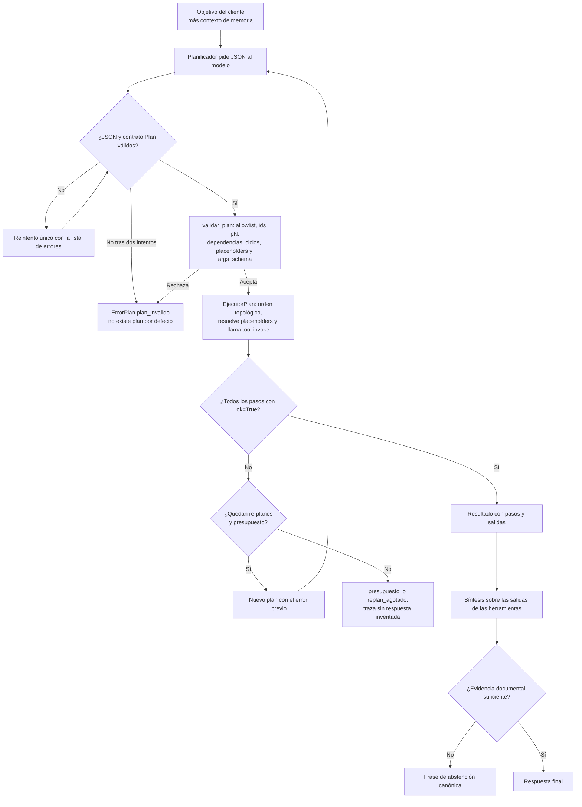

# Asistente documental y agente de soporte de TecnoApoyo

Proyecto del curso ISY0101 - Ingeniería de Soluciones con IA. TecnoApoyo es una
pyme ficticia de reparación de computadores en Santiago. El sistema responde
consultas de clientes a partir de la documentación oficial de la empresa
(procedimientos y preguntas frecuentes), se abstiene cuando no hay evidencia y,
desde RA2, opera como un agente con herramientas de consulta, escritura y
razonamiento, memoria de corto y largo plazo, y un modo de planificación
explícita con re-planificación acotada.

El motor de recuperación usa LangChain y FAISS sobre un endpoint compatible con
OpenAI. La configuración documentada apunta a la API de Mistral con
`ministral-8b-latest` para chat y `mistral-embed` para embeddings, pero el
proveedor, el endpoint y los modelos se definen por variables de entorno. Los
valores por defecto del código usan un Ollama local.

## Contenido

- [Qué es el proyecto](#qué-es-el-proyecto)
- [Arquitectura](#arquitectura)
- [Responsabilidades por módulo](#responsabilidades-por-módulo)
- [Requisitos e instalación](#requisitos-e-instalación)
- [Configuración](#configuración)
- [Flujo de ejecución](#flujo-de-ejecución)
- [Consola interactiva](#consola-interactiva)
- [Herramientas del agente](#herramientas-del-agente)
- [Modelo de memoria](#modelo-de-memoria)
- [Modos reactivo y planificado](#modos-reactivo-y-planificado)
- [Ciclo de planificación y re-planificación](#ciclo-de-planificación-y-re-planificación)
- [Contratos y errores](#contratos-y-errores)
- [Observabilidad](#observabilidad)
- [Mapa IL2.1-IL2.4](#mapa-il21-il24)
- [Evaluación existente](#evaluación-existente)
- [Límites y riesgos](#límites-y-riesgos)
- [Estructura del proyecto](#estructura-del-proyecto)

## Qué es el proyecto

Un asistente de atención al cliente que combina un motor RAG con un agente
basado en *function calling*. El agente decide qué herramienta usar en cada
paso, puede consultar la documentación y los casos de soporte, calcular plazos
en días hábiles y proponer escrituras sobre los casos. Toda escritura sobre
casos requiere confirmación humana explícita en la consola; sin confirmación no
se modifica nada.

## Arquitectura


La consola construye un `RAGEngine`, una `Memoria` y, en la primera consulta,
un `AgenteTecnoApoyo` con las herramientas ya cableadas al repositorio de casos
y al motor RAG. El agente no reemplaza al motor: lo expone como la herramienta
`buscar_documentacion`, de modo que el umbral de abstención y la recuperación
siguen siendo los del motor.

## Responsabilidades por módulo

| Módulo | Responsabilidad |
|---|---|
| `src/config.py` | Configuración central: rutas, proveedor y modelos, chunking, recuperación y variables de la capa de agentes. Resuelve rutas relativas contra la raíz y marca los valores inválidos que caen al default. |
| `src/rag.py` | `RAGEngine`: carga el índice FAISS, recupera fragmentos con score, arma el prompt fundamentado, decide la abstención por umbral o por respuesta del modelo, y devuelve documentos, latencia, tokens y error del proveedor. |
| `src/herramientas.py` | Contrato `ResultadoHerramienta`, funciones puras y tools registradas para el modelo, inyección del `Confirmador` y cálculo determinista de plazos en días hábiles. |
| `src/casos.py` | `RepositorioCasos` sobre SQLite: casos y notas, allowlist de estados y prioridades, ids secuenciales estables, siembra idempotente y `ErrorCaso`. |
| `src/agente.py` | `AgenteTecnoApoyo`: bucle de *tool calling* con tope de pasos, guard duro de abstención, integración con memoria, despacho al modo planificado y síntesis final sobre las salidas de las herramientas. |
| `src/memoria.py` | `MemoriaCortoPlazo` (buffer, ventana y resumen), `MemoriaLargoPlazo` (hechos, sesiones y turnos en SQLite), fachada `Memoria` y resumidor LLM con respaldo local. |
| `src/planificador.py` | Contrato `Plan`/`PasoPlan`, `validar_plan`, `EjecutorPlan`, `OrquestadorPlanificado` y `ErrorPlan` con códigos estables. |
| `src/observabilidad.py` | Traza por turno en JSONL con un archivo por día, saneado de claves sensibles, lectura tolerante, agregados para `/stats` y extracción de fuentes documentales. |
| `src/app.py` | Consola interactiva: comandos, confirmación de escrituras, traza por turno, fuentes documentales, estadísticas y gestión de sesiones guardadas. |
| `scripts/build_index.py` | Carga el corpus, compara configuraciones de chunking, genera embeddings y construye el índice FAISS con metadatos. |
| `scripts/generar_corpus.py` | Genera el corpus local y el dataset de evaluación sin llamar al proveedor. |
| `scripts/evaluate.py` | Evalúa el motor RAG sobre el dataset, calcula métricas, latencias y costo estimado. |
| `scripts/comparar_modos.py` | Ejecuta las mismas consultas en modo reactivo y planificado y guarda la comparación en `evaluation/results/`. |

## Requisitos e instalación

- Python 3.10 o superior.
- Acceso de red y una clave válida del proveedor para construir el índice, usar
  la consola, ejecutar la evaluación y comparar modos. La generación del corpus
  es local y no llama al proveedor.
- PowerShell para los comandos de esta guía; los mismos comandos funcionan en
  cualquier shell con el entorno virtual activado.

```powershell
python --version
python -m venv .venv
.\.venv\Scripts\Activate.ps1
pip install -r requirements.txt
pip install -r requirements-dev.txt   # solo para ejecutar las pruebas
```

Si el entorno virtual ya existe con otro nombre, reemplaza `.venv` en la ruta
de activación por el nombre real de la carpeta. Por ejemplo, con un entorno
llamado `venv`, usa `.\venv\Scripts\Activate.ps1`.

Las pruebas se ejecutan desde la raíz del proyecto:

```powershell
python -m pytest -q
```

La suite no llama al proveedor: el modelo y el motor se inyectan como dobles en
los tests del agente y del planificador.

## Configuración

`src/config.py` carga `RAIZ/.env` con `python-dotenv` si el archivo existe. Un
valor no definido toma el default de la tabla; una ruta relativa se resuelve
contra la raíz del proyecto, no contra el directorio de trabajo.

El archivo `.env.example` del repositorio no refleja la capa de agentes; esta
tabla es la fuente de verdad de las variables.

### Proveedor y recuperación

| Variable | Valor por defecto | Efecto |
|---|---|---|
| `LLM_BASE_URL` | `http://localhost:11434/v1` | Endpoint compatible con OpenAI para chat y embeddings. |
| `LLM_API_KEY` | `ollama` | Clave del endpoint. Para un proveedor remoto, define la clave real. |
| `LLM_MODELO` | vacío: usa `LLM_MODEL`; si tampoco está, `llama3.2:3b` | Modelo de chat del motor RAG y de la síntesis. |
| `LLM_MODEL` | `llama3.2:3b` (solo si `LLM_MODELO` está vacío) | Nombre alternativo del modelo de chat, por compatibilidad con el material del curso. |
| `EMBEDDING_MODELO` | `nomic-embed-text` | Modelo de embeddings. El índice queda atado a este valor: si cambia, hay que reconstruirlo. |
| `TEMPERATURA` | `0.1` | Temperatura del chat. |
| `TOP_K` | `3` | Cantidad de fragmentos que recupera el motor RAG. |
| `UMBRAL_ABSTENCION` | `0.45` | Similitud mínima para intentar responder. Debe recalibrarse si cambia el modelo de embeddings. |

`LLM_MODEL_SMALL` no se lee en el código. `OPENAI_API_KEY` tampoco: el runtime
usa `LLM_BASE_URL` y `LLM_API_KEY`. Las variables `LANGCHAIN_TRACING_V2`,
`LANGCHAIN_API_KEY` y `LANGCHAIN_PROJECT` las consume LangSmith cuando la
librería está instalada y el trazado está activo; el proyecto no las lee
directamente.

### Capa de agentes, memoria y planificación

| Variable | Valor por defecto | Efecto |
|---|---|---|
| `AGENTE_MAX_PASOS` | `6` | Tope de iteraciones del bucle reactivo y tope que el agente pasa al planificador. Un valor menor que 1 se eleva a 1. |
| `AGENTE_MODELO` | vacío: usa `LLM_MODELO` | Modelo que decide las llamadas a herramientas y produce el plan. |
| `MEMORIA_ESTRATEGIA` | `ventana` | Estrategia de corto plazo: `buffer`, `ventana` o `resumen`. Un valor no reconocido cae a `ventana`. |
| `MEMORIA_VENTANA` | `6` | Turnos conservados por la estrategia de ventana. Un valor menor que 1 se eleva a 1. |
| `MEMORIA_RESUMIDOR` | `llm` | Resumidor de la estrategia `resumen`: `llm` (con respaldo local) o `local` (sin red). Un valor no reconocido cae a `llm`. |
| `AGENTE_MODO` | `reactivo` | Modo inicial: `reactivo` o `planificado`. Un valor no reconocido cae a `reactivo`. |
| `PLAN_MAX_PASOS` | `6` | Tope de pasos de un plan y presupuesto global por consulta en modo planificado. Es independiente de `AGENTE_MAX_PASOS`, que gobierna el bucle reactivo. |
| `PLAN_MAX_REPLANES` | `1` | Re-planificaciones permitidas por consulta. `0` desactiva el re-plan. |
| `RUTA_CASOS` | `data/output/casos.db` | Base SQLite de casos de soporte. |
| `RUTA_MEMORIA` | `data/output/memoria.db` | Base SQLite de hechos y sesiones. |
| `RUTA_TRAZAS` | `data/output/trazas` | Directorio de trazas: un archivo JSONL por día (`trazas_AAAA-MM-DD.jsonl`). |

### Evaluación

| Variable | Valor por defecto | Efecto |
|---|---|---|
| `TARIFA_IN_CLP` | `145` | CLP por millón de tokens de entrada, usados por `scripts/evaluate.py` para el costo estimado. |
| `TARIFA_OUT_CLP` | `580` | CLP por millón de tokens de salida. |

No son tarifas verificadas del proveedor: son referencias configurables. Antes
de interpretar el costo como representativo, define ambas con las tarifas
vigentes.

Rutas fijas, no configurables por entorno: `data/corpus/`,
`evaluation/dataset_evaluacion.json`, `evaluation/results/`,
`data/output/indice_faiss/`, `data/output/documentos.json` y la semilla de casos
`data/casos_semilla.json`.

## Flujo de ejecución

Ejecuta los pasos desde la raíz del proyecto y en este orden.

1. Genera el corpus y el dataset de evaluación. Es local, sin llamadas al
   proveedor:

   ```powershell
   python scripts/generar_corpus.py
   ```

   Salida esperada: 10 procedimientos, 30 FAQ y 41 consultas (31 respondibles y
   10 de abstención), además de `data/entidades.json`.

2. Construye el índice FAISS. Solicita embeddings y ejecuta una consulta de
   prueba al modelo de chat, así que puede generar cargos reales:

   ```powershell
   python scripts/build_index.py
   ```

   El script compara las tres configuraciones de chunking de
   `config.CONFIGURACIONES_CHUNKING` (200/20, 350/50 y 500/75), escribe el
   reporte en `data/output/chunking_report.json` y elige la configuración cuya
   longitud media queda más cerca de su `chunk_size`. El índice y sus metadatos
   quedan en `data/output/`. En la ejecución documentada se generaron 78 chunks
   con 200 caracteres y overlap de 20. Reconstruye el índice si cambia
   `EMBEDDING_MODELO` o el corpus.

3. Inicia la consola. La invocación como módulo debe ejecutarse desde la raíz y
   requiere el índice del paso anterior; sin él, `python -m src.app` falla con
   un `FileNotFoundError` que indica ejecutar `build_index.py`:

   ```powershell
   python -m src.app
   ```

4. Ejecuta la evaluación del motor RAG sobre las 41 consultas. Llama al
   proveedor y escribe resultados con fecha y hora en `evaluation/results/`
   como `.json` y `.txt`:

   ```powershell
   python scripts/evaluate.py
   ```

5. Opcional: compara los dos modos del agente con las mismas consultas. Requiere
   red e índice construido, y escribe
   `evaluation/results/comparacion_modos_<marca>.json`:

   ```powershell
   python scripts/comparar_modos.py
   python scripts/comparar_modos.py "¿Cuánto demora el diagnóstico?"
   ```

   Sin argumentos usa cinco consultas por defecto. Las escrituras se rechazan
   con un confirmador que siempre responde que no, de modo que la comparación
   mide selección de herramientas y orquestación, no la confirmación humana.

## Consola interactiva

La consola responde a través del agente, mantiene el historial de la sesión y
escribe una traza por turno en `RUTA_TRAZAS`. Los comandos se reconocen sin
distinguir mayúsculas.

| Comando | Acción |
|---|---|
| `/ayuda` | Muestra los comandos disponibles. |
| `/trazo on` | Muestra los pasos ejecutados, su estado y las fuentes documentales con su relevancia. |
| `/trazo off` | Oculta la traza de pasos y fuentes. |
| `/modo` | Muestra el modo actual (`reactivo` o `planificado`). |
| `/modo reactivo` | Cambia al bucle reactivo para las siguientes consultas. |
| `/modo planificado` | Cambia al modo con plan y re-planificación. |
| `/guardar` | Abre una sesión nueva en `memoria.db` y escribe los turnos acumulados del motor (pregunta y respuesta de cada consulta). No acepta argumentos. |
| `/sesiones` | Lista las últimas 20 sesiones guardadas con su identificador y fecha de creación. |
| `/cargar <id>` | Restaura los turnos de una sesión en la memoria de corto plazo y la deja activa. Si no existe, no altera la memoria actual. |
| `/memoria` | Lista los hechos recordados del usuario con su fecha de actualización. |
| `/memoria borrar <clave>` | Borra un hecho recordado. Informa si la clave no existía. |
| `/trazas` | Muestra las últimas 10 trazas del día con hora, modo, cantidad de pasos, tokens, abstención y error. |
| `/stats` | Resume las trazas persistidas: consultas, abstenciones, pasos totales, distribución de herramientas y de modos. |
| `/salir` | Termina la aplicación. También acepta `/exit` y `/quit`. |

Cada `/guardar` crea una sesión nueva con el historial acumulado hasta ese
momento; no vacía el historial ni actualiza una sesión anterior.

`/modo` cambia `config.AGENTE_MODO` en memoria y el agente se reconstruye en la
siguiente consulta. El cambio no se persiste en `.env`: al reiniciar, vuelve al
valor de `AGENTE_MODO`.

Para una prueba rápida dentro del alcance documentado, consulta `¿Cuánto cuesta
el diagnóstico básico?`. Como prueba fuera de alcance, usa `¿Cuál es el estado
de mi orden de servicio 4590?`: la aplicación no consulta estados de órdenes y
el asistente debe abstenerse.

## Herramientas del agente

`src/herramientas.py` expone ocho tools al modelo; el agente agrega `recordar`
cuando tiene memoria. Todas devuelven JSON serializable con el contrato
`ResultadoHerramienta`.

| Herramienta | Familia | Argumentos | Efecto | ¿Confirmación humana? |
|---|---|---|---|---|
| `buscar_documentacion` | consulta | `pregunta` (3 a 500 caracteres), `k` (1 a 10, por defecto 3) | Recupera fragmentos de la documentación y devuelve `fragmentos`, `mejor_score`, `umbral` y `evidencia_suficiente`. No redacta la respuesta. | No |
| `consultar_caso` | consulta | `id_caso` con formato `CASO-NNNN` | Devuelve el caso con sus notas, o un error si no existe. | No |
| `listar_casos` | consulta | `estado` opcional (allowlist), `limite` (1 a 50, por defecto 10) | Lista casos, opcionalmente filtrados por estado, con el total. | No |
| `crear_caso` | escritura | `cliente`, `categoria`, `descripcion`, `prioridad` (`baja`, `media`, `alta`; por defecto `media`), `procedimiento` opcional `PROC-NNN` | Crea un caso con id secuencial `CASO-NNNN` y estado `abierto`. | Sí |
| `agregar_nota` | escritura | `id_caso`, `nota` (3 a 1000 caracteres) | Agrega una nota al caso en la tabla `casos_notas`. | Sí |
| `actualizar_estado` | escritura | `id_caso`, `estado` (`abierto`, `en_progreso`, `escalado`, `cerrado`) | Cambia el estado del caso. La confirmación muestra el estado anterior y el nuevo. | Sí |
| `escalar_a_humano` | escritura | `id_caso`, `motivo` (3 a 500 caracteres) | Marca el caso como `escalado` y deja el motivo como nota con el prefijo `Escalado:`. | Sí |
| `calcular_plazo` | razonamiento | `tipo_servicio`, `fecha_inicio` ISO opcional (por defecto hoy), `dias_habiles_extra` (0 a 30) | Calcula la fecha comprometida en días hábiles. Es determinista y no usa el modelo. | No |
| `recordar` | memoria | `clave` (2 a 60 caracteres), `valor` (2 a 500 caracteres) | Guarda o actualiza un hecho duradero del usuario. Solo existe si el agente recibió una memoria. | No |

Plazos base de `calcular_plazo`, tomados de la tabla `PLAZOS_HABILES` del
módulo:

| `tipo_servicio` | Días hábiles |
|---|---:|
| `diagnostico` | 2 |
| `revision` | 1 |
| `reparacion` | 5 |
| `repuesto` | 7 |
| `formateo` | 1 |
| `respaldo_datos` | 2 |
| `mantenimiento_preventivo` | 3 |
| `actualizacion_software` | 2 |

El cálculo suma `dias_habiles_extra`, salta sábados y domingos y no considera
feriados. Un tipo desconocido o una fecha inválida devuelven `ok=False` con el
detalle.

Las herramientas de escritura no incluyen un campo `confirmado` en su esquema y
los esquemas declaran `extra="forbid"`: si el modelo envía un campo no
declarado, la validación Pydantic rechaza la llamada completa y no se ejecuta
ninguna escritura. La confirmación es una función `Confirmador` que inyecta el
ejecutor; la consola la implementa con `rich.prompt.Confirm` y valor por
defecto `False`. Sin confirmador, o si la persona responde que no, la
herramienta devuelve `ok=False` y el caso no se modifica.

## Modelo de memoria

La memoria tiene dos horizontes y una fachada que los combina.

### Corto plazo

`MemoriaCortoPlazo` mantiene el historial que viaja en el prompt del agente.
`MEMORIA_VENTANA` cuenta turnos, es decir mensajes individuales
(`usuario` o `asistente`), no pares de pregunta y respuesta. Hay tres
estrategias:

| Estrategia | Comportamiento |
|---|---|
| `buffer` | Conserva todos los turnos, sin recorte. |
| `ventana` | Conserva los últimos `MEMORIA_VENTANA` turnos y descarta los anteriores. Es el default. |
| `resumen` | Conserva los últimos `MEMORIA_VENTANA` turnos y pliega los que salen de la ventana con un resumidor. |

El resumidor de la estrategia `resumen` se elige con `MEMORIA_RESUMIDOR`:

- `llm` (default): `resumir_con_llm` pide al modelo un resumen acotado a 120
  palabras, conservando hechos, preferencias, identificadores `CASO-NNNN` y
  decisiones. Va envuelto en `ResumidorConFallback`: si el proveedor falla, usa
  el resumidor local y cuenta el fallo en `fallos`.
- `local`: usa siempre `resumidor_por_defecto`, que concatena `rol: contenido`
  y conserva la cola más reciente hasta 600 caracteres. No toca la red.

Si se pide `llm` sin un modelo inyectado, `crear_resumidor` devuelve el
resumidor local: el arranque no depende de que el proveedor esté disponible. El
resumidor local es un respaldo, no la estrategia de resumen: concatenar y
recortar conserva texto, pero no condensa.

### Largo plazo

`MemoriaLargoPlazo` persiste en SQLite (`RUTA_MEMORIA`):

- **Hechos**: una fila por `(usuario, clave)` con `valor` y `actualizado_en`. Un
  segundo `recordar` sobre la misma clave actualiza el valor, no duplica la
  fila. El usuario por defecto es `por_defecto`.
- **Sesiones**: identificadores secuenciales `SES-NNNN` con fecha de creación.
- **Turnos**: `rol`, `contenido` y fecha, asociados a una sesión. Un turno de
  una sesión inexistente se rechaza.

Los hechos relevantes para una consulta se eligen por coincidencia léxica de
palabras: se normalizan a minúsculas y sin tildes, se descartan palabras vacías
y las de menos de tres letras, y se puntúa cuántas palabras de la consulta
aparecen en la clave o el valor. Los empates se resuelven por recencia y, si no
hay ninguna coincidencia, se usan los hechos más recientes. El bloque inyectado
respeta un presupuesto de 400 caracteres. Es una selección léxica, no semántica.

La fachada `Memoria` agrega cada turno al corto plazo y, si hay una sesión
abierta, también lo persiste. La sesión se abre con `/guardar` o `/cargar`; sin
una sesión abierta, los turnos viven solo en el corto plazo del proceso.

El agente compone el prompt de sistema con dos bloques, en este orden:
`Historial reciente:` (el texto del corto plazo, recortado a 1500 caracteres
conservando la cola) y `Memoria relevante del usuario:` (los hechos
seleccionados). El planificador recibe el mismo contexto. Sin memoria, el prompt
queda igual que antes. La tool `recordar` permite guardar hechos; un fallo de
memoria no interrumpe la conversación.

### Comandos de memoria

| Comando | Efecto |
|---|---|
| `/memoria` | Tabla de hechos del usuario con clave, valor y fecha de actualización. |
| `/memoria borrar <clave>` | Borra el hecho indicado; informa si no existía. |
| `/sesiones` | Lista las sesiones guardadas. |
| `/cargar <id>` | Restaura una sesión en el corto plazo y la deja activa. Si el id no existe, lanza `ErrorMemoria` antes de tocar el historial, así que la sesión actual no se pierde. |
| `/guardar` | Guarda el historial acumulado como una sesión nueva y devuelve su id. |

## Modos reactivo y planificado

El agente tiene dos formas de resolver una consulta, comparables entre sí:

- **Reactivo** (`AGENTE_MODO=reactivo`, default): el modelo recibe la pregunta y
  las herramientas, elige llamadas, el ejecutor las corre y devuelve cada
  resultado como `ToolMessage`. Repite hasta que el modelo deja de pedir
  herramientas o se agota `AGENTE_MAX_PASOS`. En cada iteración decide con el
  resultado de la anterior; no hay un plan previo.
- **Planificado** (`AGENTE_MODO=planificado`): antes de tocar una herramienta,
  el modelo produce un plan JSON con objetivo, pasos, dependencias y criterio de
  éxito. El plan se valida de forma determinista, se ejecuta en orden
  topológico y, si un paso falla, el orquestador puede re-planificar dentro del
  presupuesto. La respuesta final se redacta sobre las salidas reales de las
  herramientas.

Cómo compararlos:

1. Cambia el modo en caliente con `/modo reactivo` o `/modo planificado`, o fija
   `AGENTE_MODO` en el entorno antes de arrancar.
2. Ejecuta `python scripts/comparar_modos.py` para medir ambos modos sobre las
   mismas consultas. El script registra respuesta, abstención, error, lista de
   herramientas, cantidad de pasos, re-planes, tokens, latencia y plan
   ejecutado.
3. Cambia las consultas pasándolas como argumentos; sin argumentos usa cinco
   consultas de prueba.

En ambos modos el guard de abstención es el mismo: si la última
`buscar_documentacion` indicó que la evidencia no alcanza y ninguna herramienta
de caso recuperó datos después, el ejecutor impone la frase canónica aunque el
modelo haya redactado una respuesta. La abstención queda bajo el control del
ejecutor, no del modelo.

## Ciclo de planificación y re-planificación



### Validación determinista

`validar_plan` no confía en el prompt. Rechaza el plan si:

- no tiene pasos o supera `PLAN_MAX_PASOS`;
- un id no tiene formato `pN` o está repetido;
- una dependencia de `depende_de` no existe;
- las dependencias forman un ciclo, lo que se detecta antes de ejecutar
  cualquier paso;
- una herramienta no está en la allowlist de tools registradas;
- un placeholder `{{pN.camino}}` referencia un paso que no está declarado en
  `depende_de`;
- los argumentos no validan contra el `args_schema` real de la herramienta.

Los argumentos se validan con el esquema Pydantic de la tool, que declara
`extra="forbid"`. Para los campos que todavía no tienen valor, porque vienen de
un placeholder, la validación usa una sonda del tipo declarado (`int` → `1`,
`float` → `1.0`, lista → `[]`, etc.) y descarta los errores de esos campos; el
valor real se valida otra vez al ejecutar.

### Placeholders y dependencias

Un placeholder tiene la forma `{{p1.datos.id}}` o
`{{p1.datos.fragmentos.0.score}}`. El ejecutor lo resuelve contra las salidas ya
producidas por los pasos anteriores. Si el valor completo es un placeholder,
conserva el tipo del dato (entero, lista, diccionario); si está embebido en un
texto, la sustitución es textual. Un camino inexistente produce
`ErrorPlan("dato_faltante")`; no se sustituye por `None`.

### Presupuesto y re-plan

El presupuesto es global por consulta y equivale a `PLAN_MAX_PASOS`. En la
consola, el agente construye el planificador con ese tope (6 por defecto);
`AGENTE_MAX_PASOS` gobierna el bucle reactivo y no el plan. El orquestador
acumula los pasos ejecutados por todos los planes:

- si no quedan pasos disponibles, termina con un error con prefijo
  `presupuesto:`;
- si el plan nuevo excede los pasos restantes, también termina con
  `presupuesto:`;
- si un paso falla y quedan re-planes (`PLAN_MAX_REPLANES=1`), pide un plan
  nuevo incluyendo el error previo;
- si se agotan los re-planes, termina con `replan_agotado:`.

El agotamiento de presupuesto o de re-planes no lanza una excepción: queda en
`ResultadoPlanificacion.error` con la traza de lo que sí se ejecutó. Una
consulta sin pasos disponibles devuelve error visible, no una respuesta
inventada.

## Contratos y errores

### `ResultadoHerramienta`

Contrato común de toda herramienta, definido en `src/herramientas.py`:

| Campo | Tipo | Significado |
|---|---|---|
| `ok` | `bool` | La operación se completó. Un `ok=False` no escribió nada. |
| `datos` | `Any` | Payload de la herramienta; `None` cuando falla. |
| `error` | `str` o `None` | Detalle del fallo; `None` cuando `ok=True`. |

`como_json()` serializa el contrato para el `ToolMessage`. El agente lee `ok` y
`error` de ese JSON para registrar el paso.

### `ErrorCaso`

Excepción de dominio del repositorio de casos, con un código estable:

| Código | Causa |
|---|---|
| `validacion` | Campo obligatorio vacío o argumento inválido. |
| `no_encontrado` | El caso no existe. |
| `estado_invalido` | Estado fuera de la allowlist. |
| `prioridad_invalida` | Prioridad fuera de la allowlist. |
| `semilla_invalida` | La semilla versionada no es JSON válido. |

### `ErrorMemoria`

| Código | Causa |
|---|---|
| `validacion` | Campo obligatorio vacío. |
| `estrategia_invalida` | Estrategia de corto plazo fuera de `buffer`, `ventana`, `resumen`. |
| `no_encontrado` | La sesión no existe. |

### `ErrorPlan`

| Código | Causa |
|---|---|
| `validacion` | El objeto recibido no es un `Plan` ni se puede convertir en uno. |
| `plan_invalido` | El modelo no produjo un plan aceptable tras el reintento. |
| `herramienta_desconocida` | La herramienta no está en la allowlist. |
| `tope_de_pasos` | El plan no tiene pasos o supera `PLAN_MAX_PASOS`. |
| `id_invalido` | Un id no tiene formato `pN`. |
| `id_duplicado` | Un id se repite. |
| `dependencia_inexistente` | `depende_de` cita un paso que no existe. |
| `ciclo` | Las dependencias no se pueden ordenar. |
| `placeholder_no_declarado` | Un placeholder cita un paso ausente de `depende_de`. |
| `argumentos_invalidos` | Los argumentos no validan contra el `args_schema`. |
| `dato_faltante` | Al resolver un placeholder, el camino no existe en la salida. |

### Regla de escritura

Ninguna escritura sobre casos ocurre sin confirmación humana. La cadena es:

1. El modelo solo puede proponer la llamada; su esquema no tiene un campo de
   confirmación y `extra="forbid"` rechaza cualquier campo inventado.
2. La tool de escritura recibe un `Confirmador` inyectado por el ejecutor. En la
   consola, ese confirmador muestra la acción y el resumen de lo que se
   escribirá, y pregunta con valor por defecto `False`.
3. Sin confirmador, con una respuesta negativa o con una excepción en el
   confirmador, la función devuelve `ok=False` y no modifica la base.

El default seguro no es "preguntar después": es "no escribir".

Además, los errores de herramienta no abortan el bucle. Una herramienta
inexistente, argumentos inválidos o una excepción dentro de la tool quedan
registrados en el paso con `ok=False`, y el modelo recibe el error para corregir
el rumbo. Un error del proveedor sí corta la consulta, pero se informa en
`error` y no se marca como abstención.

## Observabilidad

Cada turno deja una traza en `RUTA_TRAZAS`, en un archivo por día llamado
`trazas_AAAA-MM-DD.jsonl`. Cada línea es un objeto JSON independiente, de modo
que una línea corrupta no invalida el resto.

La traza contiene `timestamp`, `modo`, `pregunta`, `respuesta`, `plan`,
`pasos`, `replanes`, `presupuesto_usado`, `tokens`, `latencia_seg`,
`abstencion`, `error`, `estrategia_memoria` y `hechos_inyectados`. Cada paso
registra `herramienta`, `argumentos`, `ok`, `error` y `duracion_seg`; la
duración se mide en el bucle reactivo, mientras que en el modo planificado el
campo queda en `0.0`.

`escribir_traza` nunca propaga una excepción: si el directorio no se puede
crear o un valor no es serializable, devuelve `None` y la respuesta continúa.
Antes de serializar se descartan, en cualquier nivel de anidamiento, las claves
cuyo nombre contenga `api_key`, `apikey`, `token_secret`, `password` o
`secret`.

`/trazas` lee las últimas 10 trazas y `/stats` resume todo el directorio:
consultas, abstenciones, pasos, conteo por herramienta y conteo por modo. La
consola también muestra por turno los pasos, las fuentes documentales
(deduplicadas, con el mejor score por documento), el modo, los re-planes, los
tokens y la latencia.

## Mapa IL2.1-IL2.4

| IL | Qué exige | Evidencia en código | Prueba |
|---|---|---|---|
| IL2.1 | Agente con herramientas de consulta, escritura y razonamiento, con confirmación y tope de iteraciones | `src/herramientas.py` (ocho tools y `recordar`, contrato `ResultadoHerramienta`, `Confirmador`), `src/agente.py` (`bind_tools`, tope, `ToolMessage`, guard de abstención), `src/casos.py` (persistencia y allowlists) | `tests/test_herramientas.py::test_el_modelo_no_puede_autoconfirmarse_una_escritura`, `tests/test_herramientas.py::test_crear_caso_sin_confirmador_no_escribe`, `tests/test_agente.py::test_tope_de_pasos_detiene_el_bucle`, `tests/test_agente.py::test_guard_fuerza_la_abstencion_si_no_hay_evidencia`, `tests/test_casos.py` |
| IL2.2 | Memoria de corto y largo plazo con continuidad entre reinicios | `src/memoria.py` (buffer, ventana, resumen con resumidor LLM y respaldo local, hechos y sesiones), integración en `src/agente.py`, comandos en `src/app.py` | `tests/test_memoria.py::test_un_hecho_sobrevive_al_reinicio`, `tests/test_memoria.py::test_resumen_conserva_los_hechos_del_turno_olvidado`, `tests/test_memoria.py::test_memoria_recarga_una_sesion_en_el_corto_plazo`, `tests/test_agente_memoria.py::test_recordar_sobrevive_al_reinicio` |
| IL2.3 | Planificación explícita, dependencias y re-plan con tope; dos modos comparables | `src/planificador.py` (contrato del plan, validación, ejecución topológica, presupuesto y re-plan), `src/agente.py` (despacho por modo y síntesis), `scripts/comparar_modos.py` | `tests/test_planificador.py::test_rechaza_placeholder_que_referencia_un_paso_no_declarado`, `tests/test_planificador.py::test_un_paso_que_falla_dispara_el_replan_y_completa`, `tests/test_planificador.py::test_presupuesto_global_agotado_por_pasos_ejecutados`, `tests/test_agente_planificado.py::test_modo_planificado_encadena_placeholder` |
| IL2.4 | Documentación técnica, orquestación y observabilidad del turno | Este `README.md`, `whitebox.md`, `informe/analisis_flujo_organizacional.md`; `src/observabilidad.py` (traza JSONL, saneado y agregados); `src/app.py` muestra pasos, fuentes, modo, re-planes, tokens y latencia por turno | `tests/test_observabilidad.py::test_saneado_descarta_api_key_y_password`, `tests/test_observabilidad.py::test_resumen_stats_agrega_consultas_pasos_y_modos`, `tests/test_observabilidad_agente.py::test_traza_de_turno_serializa_el_plan`, `tests/test_observabilidad_agente.py::test_la_traza_armada_se_escribe_y_se_relee` |

## Evaluación existente

La evaluación del repositorio mide el motor RAG, no al agente: `scripts/evaluate.py`
invoca `RAGEngine.consultar()` sobre las 41 consultas y no ejecuta herramientas
ni planificación. Ejecución del 25 de septiembre de 2026 con
`ministral-8b-latest`, `mistral-embed`, 40 documentos, `TOP_K=3` y chunking de
200/20 (78 chunks):

| Métrica | Resultado |
|---|---:|
| Exactitud | 90.2% |
| Precisión | 93.5% |
| Recall | 93.5% |
| Especificidad | 80.0% |
| Hit rate @3 | 100.0% |
| Latencia promedio / máxima | 1.91 s / 5.33 s |
| Tiempo total | 78.1 s |
| Tokens de entrada / salida | 17,281 / 1,779 |
| Errores del proveedor | 0 |
| Costo estimado del reporte (referencial) | CLP $4 |

Matriz de confusión:

| Resultado del asistente | Esperado: responde | Esperado: abstiene |
|---|---:|---:|
| Responde | TP = 29 | FP = 2 |
| Se abstiene | FN = 2 | TN = 8 |

Los dos falsos positivos fueron `¿Atienden celulares?` y `¿Con quién hablo para
reclamar a la central?`; los dos falsos negativos fueron `¿Mi garantía cubre si
se me cayó té al teclado?` y `¿Los datos que respaldan se borran después?`.

En esa corrida, los puntajes superiores estuvieron entre `0.5746` y `0.8673`:
ninguno quedó bajo `UMBRAL_ABSTENCION=0.45`, así que el filtro de similitud no
se activó y las abstenciones observadas las decidió el modelo a partir del
prompt. El umbral sigue sin validación empírica.

Evidencia: [JSON](evaluation/results/evaluacion_2026-09-25_20-41-41.json) y
[resumen TXT](evaluation/results/evaluacion_2026-09-25_20-41-41.txt).

## Límites y riesgos

- **La evaluación mide el motor RAG, no al agente.** No existe en el repositorio
  un conjunto de evaluación de selección de herramientas, argumentos, escritura
  confirmada o calidad de planes. Los tests del agente prueban el ejecutor con
  modelos falsos, no el comportamiento de un modelo real.
- **La comparación de modos no está ejecutada.** `scripts/comparar_modos.py`
  requiere red e índice construido, y no hay archivo
  `evaluation/results/comparacion_modos_*.json` en el repositorio. La
  comparación es una capacidad disponible, no un resultado medido.
- **`calcular_plazo` ignora los feriados.** Solo salta sábados y domingos. Un
  plazo comprometido puede caer en un feriado; el cálculo es determinista, pero
  no conoce el calendario legal chileno.
- **La memoria de largo plazo es léxica, no semántica.** Selecciona hechos por
  coincidencia de palabras normalizadas y cae a recencia cuando no hay
  coincidencias. Dos formas de decir lo mismo con vocabulario distinto no se
  relacionan.
- **El resumidor local es un respaldo.** Concatena y recorta; no condensa. Si el
  proveedor falla durante la estrategia `resumen`, el historial se conserva
  degradado y el contador `fallos` aumenta, pero la consola no lo muestra.
- **El umbral de abstención no está calibrado.** Depende del modelo de
  embeddings y en la corrida documentada no se activó. Cambiar
  `EMBEDDING_MODELO` obliga a reconstruir el índice y a revisar el umbral.
- **El índice queda atado al modelo de embeddings.** Construirlo y consultarlo
  con modelos distintos produce resultados sin sentido.
- **La configuración por defecto apunta a Ollama local.** Para reproducir la
  corrida documentada con Mistral hay que definir `LLM_BASE_URL`,
  `LLM_API_KEY`, `LLM_MODELO` y `EMBEDDING_MODELO` en `.env`.
- **Costo y disponibilidad dependen del proveedor.** Las tarifas del evaluador
  son referencias configurables, no una factura. Las llamadas de chat y
  embeddings pueden fallar por cuota, red o timeout; el motor y el agente
  informan el error, pero no reintentan.
- **La persistencia de turnos requiere una sesión abierta.** Sin `/guardar` o
  `/cargar`, el historial vive solo en memoria y se pierde al cerrar el proceso.
- **Cada `/guardar` duplica el historial acumulado en una sesión nueva.** No
  actualiza la sesión anterior ni vacía el historial.

## Estructura del proyecto

```text
.
├── data/
│   ├── corpus/
│   │   ├── procedimientos/       # 10 procedimientos en Markdown
│   │   └── faq/                  # 30 preguntas frecuentes en Markdown
│   ├── casos_semilla.json        # 10 casos de soporte versionados
│   ├── entidades.json            # entidades del negocio
│   └── output/                   # índice FAISS, bases SQLite, reportes y sesiones
├── evaluation/
│   ├── dataset_evaluacion.json   # consultas y documentos esperados
│   └── results/                  # resultados JSON/TXT por ejecución
├── scripts/
│   ├── generar_corpus.py         # corpus y dataset
│   ├── build_index.py            # chunking, embeddings e índice FAISS
│   ├── evaluate.py               # métricas del motor RAG y costos estimados
│   └── comparar_modos.py         # reactivo vs. planificado
├── src/
│   ├── config.py                 # configuración central
│   ├── rag.py                    # motor RAG, abstención y trazabilidad
│   ├── herramientas.py           # tools y contratos
│   ├── casos.py                  # repositorio SQLite de casos
│   ├── memoria.py                # memoria de corto y largo plazo
│   ├── planificador.py           # plan, validación, ejecución y re-plan
│   ├── observabilidad.py         # trazas JSONL, saneado y agregados
│   ├── agente.py                 # bucle reactivo y modo planificado
│   └── app.py                    # interfaz de consola
├── tests/                        # suite sin red
├── informe/                      # memoria técnica del proyecto
├── requirements.txt
└── requirements-dev.txt
```
