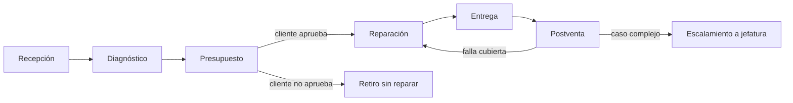

# Análisis del flujo organizacional y tareas cognitivas de TecnoApoyo

**Proyecto:** asistente documental y agente de soporte de TecnoApoyo.
**Alcance:** flujo de soporte de punta a punta, tareas cognitivas complejas,
frontera entre automatización y decisión humana, y correspondencia con las
herramientas implementadas en RA2.
**Fuentes:** corpus versionado en `data/corpus/` (10 procedimientos y 30
preguntas frecuentes), semilla de casos en `data/casos_semilla.json` y código de
`src/`. Las referencias documentales se citan por identificador; el
comportamiento descrito del sistema corresponde a lo que implementan los
módulos, no a una proyección.

## 1. Propósito

TecnoApoyo recibe equipos, diagnostica fallas, presupuesta reparaciones, las
ejecuta, entrega el equipo y responde por garantías. Cada etapa combina
atención al cliente con decisiones técnicas y comerciales. Este documento
describe ese flujo, identifica las tareas cognitivas que exige y establece qué
parte puede automatizar el agente y qué parte debe quedar en manos de una
persona, con el criterio usado para trazar esa frontera.

## 2. Flujo de soporte de punta a punta

### 2.1 Recepción

El cliente llega al taller o solicita retiro. Recepción registra sus datos,
describe el síntoma, asigna una orden de servicio y entrega un comprobante; el
técnico hace un diagnóstico inicial de hasta 15 minutos y se informa un plazo de
diagnóstico de 48 horas hábiles (PROC-001).

Decisiones de la etapa:

- **¿Se recibe el equipo para diagnóstico o se deriva?** La recepción define el
  alcance del trabajo y el estado inicial del caso.
- **¿Corresponde retiro a domicilio?** Solo dentro del radio de Santiago y
  comunas aledañas, con costo de 5000 pesos por traslado, coordinado con al
  menos un día de anticipación y con dirección, contacto y ventana horaria
  (PROC-007).
- **¿Se autoriza respaldo previo?** Es recomendado antes de cualquier
  intervención, cuesta 10000 pesos adicionales y el taller no responde por
  pérdida de datos si el cliente no lo autoriza (PROC-008).
- **¿Cómo se tratan los datos del cliente?** Solo para la gestión de la orden,
  sin compartirlos con terceros sin consentimiento (PROC-010).
- **¿Qué prioridad tiene el caso?** La semilla usa `baja`, `media` y `alta`; la
  prioridad afecta el orden de atención, no el plazo técnico.

Apoyo del sistema: `buscar_documentacion` para políticas de recepción, retiro,
respaldo y privacidad; `crear_caso` para registrar el ingreso, siempre con
confirmación humana; `consultar_caso` y `listar_casos` para verificar el estado
antes de prometer algo.

### 2.2 Diagnóstico

El técnico determina la falla, su causa y el trabajo necesario. El diagnóstico
básico cuesta 15000 pesos y se descuenta si el cliente repara en TecnoApoyo
(PROC-004). El plazo informado es de 48 horas hábiles (PROC-001, FAQ-003).

Decisiones de la etapa:

- **¿La falla está cubierta por garantía de fábrica?** Cubre defectos de
  fabricación durante 24 meses desde la compra, no cubre mal uso, golpes ni
  daños por líquidos o sobrecargas, y exige boleta y ausencia de manipulación no
  autorizada (PROC-002, PROC-005).
- **¿Aplica garantía extendida?** Agrega 12 meses al período de fábrica y cubre
  fallas de hardware, excluyendo líquido y golpes (PROC-002).
- **¿Qué pieza se instalará?** Las originales tienen garantía de 6 meses; las
  alternativas compatibles, 3 meses (PROC-005).
- **¿Se requiere respaldo antes de intervenir?** Aplica la política de
  PROC-008.
- **¿El trabajo es mantenimiento, actualización o reparación?** Cambia el
  procedimiento, el plazo y el precio (PROC-003, PROC-009, PROC-004).

Apoyo del sistema: `buscar_documentacion` para política vigente;
`calcular_plazo` con `tipo_servicio=diagnostico` para la fecha comprometida;
`agregar_nota` para dejar constancia del diagnóstico; `actualizar_estado` para
mover el caso a `en_progreso` cuando corresponda.

### 2.3 Presupuesto

Cuando la reparación supera los 25000 pesos se entrega un presupuesto detallado
que el cliente debe aprobar por escrito antes de continuar (PROC-004). El
presupuesto tiene validez de 10 días hábiles; si aparecen piezas no
consideradas, se emite uno nuevo.

Decisiones de la etapa:

- **¿Se requiere presupuesto formal?** Sí cuando el monto supera el umbral de
  25000 pesos (PROC-004).
- **¿Se acepta el presupuesto y en qué plazo?** La aprobación es escrita y el
  documento vence a los 10 días hábiles (PROC-004, PROC-006).
- **¿Cómo se paga?** Los precios incluyen IVA; con presupuesto de 50000 pesos o
  más se exige 50% de abono anticipado; no hay pagos en cuotas (PROC-006,
  FAQ-009, FAQ-030).
- **¿Qué pasa si el cliente rechaza?** Puede retirar el equipo sin reparar
  pagando solo el diagnóstico (PROC-004).
- **¿Cambió el alcance?** Un hallazgo nuevo obliga a un presupuesto adicional
  antes de instalar la pieza (PROC-004).

Apoyo del sistema: `buscar_documentacion` para precios y condiciones;
`calcular_plazo` con `reparacion` o `repuesto` para la fecha estimada;
`agregar_nota` para registrar el envío y la respuesta del cliente;
`actualizar_estado` para reflejar el avance. El agente no emite presupuestos ni
calcula precios: la tabla de precios vive en la documentación y el documento
comercial lo prepara una persona.

### 2.4 Reparación

Se ejecuta el trabajo aprobado. Antes de intervenir se recomienda respaldar la
información; el respaldo se guarda en disco externo encriptado y se conserva en
el taller hasta 15 días (PROC-008). El mantenimiento preventivo incluye limpieza
interna, pasta térmica, revisión de temperatura y controladores, y toma entre 60
y 90 minutos (PROC-003). La actualización de software verifica requisitos
mínimos y respalda la configuración (PROC-009).

Decisiones de la etapa:

- **¿Se respaldó antes de intervenir?** Condiciona la responsabilidad del taller
  sobre los datos (PROC-008).
- **¿Aparece una pieza o mano de obra no presupuestada?** Se detiene el trabajo
  y se genera un nuevo presupuesto (PROC-004).
- **¿La reparación puede continuar?** Si el cliente cancela antes de iniciar, no
  se cobra la reparación; si ya inició, se cobran diagnóstico y piezas
  instaladas (FAQ-025).
- **¿El trabajo excede la política o el alcance técnico?** Se escala a jefatura.

Apoyo del sistema: `buscar_documentacion` para el procedimiento aplicable;
`calcular_plazo` para el plazo de reparación o de repuesto;
`agregar_nota` para la bitácora; `escalar_a_humano` para derivar un caso que
requiere una decisión fuera de política.

### 2.5 Entrega

Se notifica al cliente que el equipo está listo, se verifica el pago y se
entrega con su respaldo. Los equipos deben retirarse dentro de 60 días desde la
notificación; después se aplica la política de equipos abandonados y pueden
quedar disponibles para terceros (FAQ-014, FAQ-024). Los datos respaldados se
eliminan de forma segura una vez entregado el equipo (PROC-008).

Decisiones de la etapa:

- **¿Está completo el pago?** Incluye diagnóstico, reparación y servicios
  adicionales (PROC-006).
- **¿Se devuelve el respaldo y se elimina?** Es parte de la política de datos
  (PROC-008, PROC-010).
- **¿El cliente retira dentro de plazo?** Pasados 60 días cambia el régimen de
  custodia (FAQ-014, FAQ-024).
- **¿Se cierra el caso?** Sí, cuando el equipo fue entregado y no queda una
  garantía activa por reportar.

Apoyo del sistema: `consultar_caso` para verificar estado y notas;
`actualizar_estado` a `cerrado` con confirmación; `buscar_documentacion` para
las condiciones de retiro y abandono.

### 2.6 Postventa

Incluye garantías, fallas recurrentes, reclamos y solicitudes sobre datos
personales. El reporte de garantía se procesa en hasta 5 días hábiles desde la
recepción del equipo y exige boleta y ausencia de daños por mal uso (PROC-005,
FAQ-016). Las reparaciones tienen garantía de 6 meses sobre las piezas originales
instaladas (FAQ-018); si la falla recurre dentro de ese período, la pieza se
reemplaza sin costo (FAQ-008). El cliente puede solicitar acceso, rectificación
o eliminación de sus datos (PROC-010).

Decisiones de la etapa:

- **¿La falla está dentro de la garantía de la reparación?** Depende de la fecha
  de entrega, del tipo de pieza y de la causa (FAQ-008, FAQ-018).
- **¿Corresponde cobro o reemplazo sin costo?** Es una decisión con efecto
  económico y requiere revisión humana.
- **¿Se reconoce la boleta y el estado del equipo?** Una boleta ilegible o un
  equipo manipulado impiden aplicar la garantía; es el motivo del caso
  `CASO-0003` de la semilla, que está `escalado`.
- **¿Se escala a jefatura?** Ante excepciones, reclamos o solicitudes de datos
  que exceden la política.
- **¿Se reabre el caso o se crea uno nuevo?** Depende de si la garantía cubre el
  mismo trabajo o es una falla distinta.

Apoyo del sistema: `buscar_documentacion` para la política vigente;
`calcular_plazo` para el plazo de reporte; `crear_caso` con categoría
`garantia`; `escalar_a_humano` cuando la decisión excede la política;
`consultar_caso` para revisar el historial y las notas.

## 3. Tareas cognitivas complejas

### 3.1 Recuperar la política vigente

El conocimiento está fragmentado en 40 documentos con versiones y fechas, y
varias políticas se solapan (por ejemplo, PROC-002 define la garantía de fábrica
y PROC-005 la gestión de reportes y la garantía de piezas). La tarea exige
localizar el documento correcto, distinguir la versión vigente y no completar
vacíos con conocimiento general.

Dificultad: el corpus es recuperable, pero no exhaustivo; una pregunta puede
tener respuesta parcial. El sistema la aborda con `buscar_documentacion`, que
devuelve fragmentos con `document_id`, versión, fecha y score, y con el verdicto
`evidencia_suficiente` calculado contra `UMBRAL_ABSTENCION`. Si la evidencia no
alcanza, el ejecutor fuerza la abstención.

### 3.2 Clasificar el caso

Clasificar significa asignar categoría, prioridad y procedimiento, y decidir si
el caso es una consulta, una recepción, un presupuesto, una garantía o un
reclamo. La semilla usa categorías como `recepcion`, `presupuesto` y `garantia`,
y vincula cada caso a un `PROC-*`.

Dificultad: una misma consulta puede pertenecer a dos etapas; la prioridad
depende de riesgo y contexto, no solo del texto. El agente puede proponer
`crear_caso` con esos campos, pero la persona confirma la escritura. La
clasificación no se automatiza por completo porque un error cambia el flujo y el
plazo que se promete al cliente.

### 3.3 Decidir el escalamiento

Escalar es reconocer que la decisión excede la política o la evidencia
disponible: una garantía con boleta ilegible, un reclamo, un caso con impacto
comercial o una solicitud de datos personales. La herramienta
`escalar_a_humano` marca el caso como `escalado` y deja el motivo como nota,
pero no decide cuándo usarla.

Dificultad: exige juicio sobre riesgo, excepciones y responsabilidad. El agente
puede proponer la escalada y dejar la justificación; la persona la autoriza.

### 3.4 Calcular plazos

Los plazos se expresan en días hábiles y varían por servicio: diagnóstico 2,
revisión 1, reparación 5, repuesto 7, formateo 1, respaldo de datos 2,
mantenimiento preventivo 3 y actualización de software 2
(`PLAZOS_HABILES` en `src/herramientas.py`). A eso se suman días extra por
complejidad.

Dificultad: un modelo de lenguaje puede equivocarse al sumar días hábiles y al
saltar fines de semana. Por eso el cálculo es determinista:
`calcular_plazo` usa una tabla y `sumar_dias_habiles`, no el modelo. Los
feriados quedan fuera del cálculo; es una limitación conocida y explícita.

### 3.5 Redactar la respuesta

La respuesta debe ser breve, en español, citar los datos del contexto y no
inventar precios, políticas ni estados. En el modo reactivo la redacta el modelo
al final del bucle; en el planificado se redacta con `PROMPT_SINTESIS` a partir
de las salidas reales de las herramientas.

Dificultad: convertir varios fragmentos y resultados de herramientas en una
respuesta coherente sin agregar información ausente. El sistema la acota con el
prompt, con la abstención canónica y con la traza de fuentes; la revisión humana
sigue siendo necesaria en comunicaciones sensibles.

### 3.6 Decidir qué se escribe

Crear un caso, agregar una nota, cambiar un estado o escalar son acciones con
efecto operativo. La decisión de escribir no es solo técnica: compromete al
taller frente al cliente.

Dificultad: un agente puede proponer una escritura plausible y equivocada. El
sistema separa la propuesta de la autorización: el esquema de la herramienta no
tiene campo de confirmación, `extra="forbid"` rechaza campos inventados y la
confirmación es una función inyectada que pregunta `s/n` en consola, con `False`
por defecto.

## 4. Qué automatiza el agente y qué queda en manos humanas

### 4.1 Automatizado

- Recuperar y citar documentación con trazabilidad de documento, versión, fecha
  y score.
- Abstenerse cuando la evidencia no alcanza el umbral o cuando el modelo no
  encuentra respaldo, con una frase canónica y verificable.
- Consultar y listar casos de soporte.
- Calcular fechas comprometidas en días hábiles.
- Redactar un borrador de respuesta fundamentado en el contexto recuperado.
- Proponer escrituras sobre casos con un resumen de lo que se modificaría.
- Recordar hechos del usuario y retomar sesiones guardadas.
- Validar un plan, ejecutarlo en orden y re-planificar dentro de un presupuesto.
- Dejar traza de pasos, herramientas, argumentos, errores, tokens y latencia
  por turno, en la consola y en un archivo JSONL diario.

### 4.2 Humano

- Autorizar cualquier escritura sobre casos (crear, anotar, cambiar estado,
  escalar).
- Aprobar presupuestos y condiciones comerciales; el agente puede recuperar la
  política, pero no emitir el documento ni fijar precios.
- Diagnosticar físicamente el equipo y decidir el trabajo técnico.
- Resolver excepciones de garantía, boletas ilegibles, reclamos y solicitudes de
  datos personales.
- Confirmar plazos comprometidos cuando el caso tiene condiciones no cubiertas
  por la tabla de plazos.
- Comunicar decisiones sensibles al cliente y asumir la responsabilidad final.

### 4.3 Criterio de la frontera

La automatización se queda con lo **determinista, reversible o de solo
lectura**: recuperar, citar, calcular una fecha con una tabla, listar casos,
proponer una acción y redactar un borrador. La persona conserva lo
**irreversible, económicamente vinculante o jurídicamente sensible**: modificar
el expediente, aprobar dinero, intervenir el equipo, reconocer una garantía
fuera de regla y tratar datos personales.

El agente puede equivocarse en la selección de herramienta o en la redacción; el
diseño asume ese error y lo contiene con tres barreras: el tope de pasos, el
guard de abstención y la confirmación humana de escrituras. Ninguna de las tres
depende de que el modelo se porte bien.

## 5. Tareas, herramientas e IL

| Tarea | Herramienta | IL | Qué aporta |
|---|---|---|---|
| Recuperar la política vigente | `buscar_documentacion` | IL2.1 | Fragmentos con score, versión, fecha y veredicto de evidencia. |
| Consultar un caso | `consultar_caso` | IL2.1 | Caso con notas o error `no_encontrado`. |
| Revisar casos abiertos | `listar_casos` | IL2.1 | Lista filtrada por estado con total. |
| Registrar una recepción | `crear_caso` | IL2.1 | Caso nuevo con id secuencial, previa confirmación. |
| Dejar constancia del diagnóstico | `agregar_nota` | IL2.1 | Nota persistida en el caso, previa confirmación. |
| Reflejar el avance del caso | `actualizar_estado` | IL2.1 | Cambio de estado con confirmación del antes y después. |
| Derivar un caso complejo | `escalar_a_humano` | IL2.1 | Estado `escalado` y motivo como nota, previa confirmación. |
| Calcular un plazo comprometido | `calcular_plazo` | IL2.1 | Fecha estimada en días hábiles, determinista. |
| Recordar un dato del cliente | `recordar` | IL2.2 | Hecho durable por usuario y clave. |
| Retomar una conversación | `/sesiones`, `/cargar` | IL2.2 | Turnos restaurados en el corto plazo. |
| Resolver una consulta multi-etapa | `Planificador`, `EjecutorPlan`, `OrquestadorPlanificado` | IL2.3 | Plan validado, ejecución topológica y re-plan acotado. |
| Comparar estrategias de resolución | `/modo`, `scripts/comparar_modos.py` | IL2.3 | Medición de pasos, re-planes, tokens y latencia por modo. |
| Revisar qué hizo el agente | `/trazo`, `/trazas`, `/stats` | IL2.4 | Pasos, fuentes, modo, re-planes, tokens y latencia del turno; últimas trazas y agregados. |

## 6. Vacíos y supuestos

- El flujo descrito se apoya en el corpus versionado; si una política cambia en
  la operación real y no se actualiza el documento, el asistente seguirá
  citando la versión del corpus.
- El sistema no gestiona pagos, emisión de presupuestos ni logística de retiro:
  solo recupera la política y registra lo que una persona autoriza.
- La tabla de plazos cubre ocho tipos de servicio y no modela feriados ni
  calendarios especiales.
- La clasificación de casos y el escalamiento son propuestas del agente
  sujetas a confirmación; no hay una regla automática que los ejecute.
- La evaluación existente mide el motor RAG sobre 41 consultas y no evalúa la
  calidad de las decisiones del agente. Las afirmaciones de esta sección sobre
  el flujo organizacional son un análisis del proceso y del diseño, no un
  resultado medido de precisión del agente.
